# Voice control for desnotch: master plan

Branch `feat/voice` (from `origin/main`, v0.11.0, `24ee5c6`). This directory holds the plan (`PLAN.md`) and one self-contained
prompt per work package (`WP-LOGIC.md`, `WP-UI.md`, `WP-PLATFORM.md`, `WP-HERMES.md`). The contracts the packages share are
compiled code under `Sources/DesnotchCore/Voice/Contracts/`. The research behind the design is not in the repo; every decision
that matters is restated here.

Status (commits "feat(voice): plan and contracts", "docs(voice): revise plan round 1", "docs(voice): revise plan round 2", "docs(voice): revise plan round 3"): the package builds
warning-free, voice is OFF by default, every seam has a fail-closed stub, and the 20 contract smoke tests plus every existing test pass under the local harness
(apart from two known baseline failures, section 12). Round 2 also removed the async `NSLock` warnings from the frozen `VoiceTestSupport.swift`, so the only
remaining harness warning outside `main.swift` is the pre-existing `UpdateCheckerTests.swift:41`.

## 1. Goal

Add optional voice control to desnotch: hold a key, speak, and either a small fixed set of local commands runs at once
(media, volume, mute, open an app, timer) or, if the user opts in, the request goes to his local Hermes agent. The notch pill
shows what was heard, what will happen, asks for visual approval when something is risky, and has a Stop that really stops.
The feature is built so that a mishear, a replayed voice, a prompt injection or a bug in the agent cannot silently do
damage: default-deny, visual-only approvals, a transcript review window before anything leaves the Mac, a hash-chained audit
log, and a deletion path of one folder and one flag.

What to expect from the Hermes lane (by design, not a defect): the `voice` profile declares an EMPTY toolset and `ToolTierTable` default-denies every tool it does not know, so any agent tool call (including Hermes-internal ones such as memory, todo or skills) classifies T3, or T2 with no card-approved start yet, and trips the wire (R83) and pauses the agent. Hermes also sends a tool's start BEFORE its permission request, so a card-approved shell command is still a tripwire pause. In the MVP the agent approval card and hold-to-approve are therefore exercised only by scripted tests; plain question-and-answer turns work, and a tripwire pause is the NORMAL, safe outcome of a tool call in the live S1/S4 runs.

## 2. Non-goals (explicit)

- No wake word and no always-on microphone. Push-to-talk only.
- No cloud speech recognition and no audio leaving the process. No whisper.cpp/Piper/AEC/barge-in/VAD endpointing (a later phase).
- No new SPM target, no new package dependency, no new permission beyond Microphone and Speech Recognition (no Accessibility, Automation, Screen Recording, Full Disk Access).
- No `cua-driver`/computer-use, no Shortcuts verb, no focus-app verb, no AppleScript, no shell from the local lane.
- No `hermes serve`, no WebSocket, no tokens: the only Hermes transport is ACP over the stdio of a child process desnotch owns.
- desnotch never creates, edits or reads secrets in `~/.hermes`. The `voice` Hermes profile is created and locked by the human.
- No T3 (network egress) approvals in the MVP (no second factor exists): T3 is denied. T4 has no voice path, ever.
- No pentest/engagement context on the voice path (no Interseptor, vault, Notion, memory MCPs).
- No spoken approval of anything. No "always allow" or "allow for session" anywhere.
- No mixed-language (code-switching) recognition: one locale per capture (`en-US` or `id-ID`).
- No Settings export/import of voice settings. No `OnboardingView` change.
- No claim of pixel-accurate notch layout on real notch hardware; that needs a MacBook (section 15).

## 3. Scope and phases

| Phase | Content | Done by | Where it is verified |
|---|---|---|---|
| P0 | Plan + contracts + stubs + harness (this commit) | plan owner | Mac mini, `swift build`, harness |
| P1 | Pure brain, UI, platform glue, in parallel | WP-LOGIC, WP-UI, WP-PLATFORM | harness per package |
| P2 | Coordinator + app wiring: local lane end to end with a typed debug command | WP-HERMES part A | harness + manual on the Mac mini |
| P3 | Real microphone, speech, hotkey, permissions on the Mac mini | human + part A fixes | manual (needs a stable signing identity to avoid TCC re-prompts) |
| P4 | Hermes lane over ACP: preflight, supervisor, approval cards, hard stop | WP-HERMES part B | harness + manual canary matrix |
| P5 | Docs (AGENTS.md, CHANGELOG, README) and review gate | WP-HERMES part C, reviewers | full verification |

MVP = P1-P3 (local lane). The Hermes lane (P4) ships dark: `voiceHermesLane` is a second opt-in and the preflight refuses
it until the human has created and locked the `voice` profile. Review gate four weeks after landing: if usage is low, delete
the feature (section 17).

## 4. Decisions locked (delegated defaults) and deviations

| Decision | Value |
|---|---|
| Speech-to-text | On-device `SFSpeechRecognizer` (`requiresOnDeviceRecognition = true`); a locale without on-device support fails, never falls back to a server |
| Hermes transport | ACP over stdio (`hermes -p voice acp`), own process group; `hermes serve` is not used |
| `voice` Hermes profile | Created and locked (`chflags uchg`) by the human later; desnotch only runs a preflight on every spawn and every session and refuses the Hermes lane until it passes; desnotch does not create it |
| MVP order | Local lane first, then Hermes lane code |
| Engagement context | Never on the voice path |
| Push-to-talk | Default hold `⌥⌘V` (also `⇧⌥⌘V`, `⌥⌘J`); hold >= 0.35 s and release commits; a tap latches a toggle capture (10 s cap); hold cap 30 s. `⌥⌘V` shadows Finder's "Move Item Here" while Finder is frontmost; the two alternatives avoid it, and the README and the Settings note for the shortcut say so |
| Stop | Notch Stop button, global chord `⌥⌘.`, status menu, Esc (soft cancel), and the spoken phrase "abort agent" (during an agent turn via a stop-only interrupt capture) |
| Daily cloud cap | 40 agent turns per local day, per-turn 180 s and 12-step budgets |
| Defaults | `voiceEnabled` false, `voiceHermesLane` false, `voiceTTSEnabled` false, `voiceDuckMedia` true, locale `en-US` |

Deviations from the research report (each deliberate):

1. **One folder, not a new SPM target.** Everything lives in `Sources/DesnotchCore/Voice/` behind one flag. Reason: the UI inside `DesnotchCore` must see the session types (a separate module would force widening internals to `public`), and a new target adds Swift 5.10 CI risk. The kill switch is still one folder (section 17).
2. **Added state `transcribing`** between "the user ended the capture" and "final text arrived", so the pill never shows a live mic after release.
3. **Volume above 70% needs an approval card** (T2), because the commonest dangerous mishear is "ten" heard as "a hundred".
4. **No VAD/latch-by-silence.** A Hermes submission requires that a user action (key release or tap) ended the capture; a cap timer or the recognizer ending on its own never submits to the cloud.
5. **Interrupt capture:** pressing the talk key while an agent works starts a second, stop-only capture so "abort agent" works while the agent runs.
6. **`VoiceClock`** instead of `Clock` (the standard library already has `Clock`).
7. **Audit anchoring** is a follow-up: the logger returns the chain head hash, but periodically anchoring it outside the file (e.g. a Notion note) is manual for now. `chflags uappend` is skipped on purpose: the file owner can clear it, so it is cosmetic.
8. **No relabelling of the mic indicator.** The research report asked to relabel `MediaUseMonitor`'s microphone dot when the capture is desnotch's own. Not in this plan (no work package owns it, and `MediaUseMonitor` is outside every voice file list); the pill's own `listening` state already shows the mic. Follow-up, not an MVP item.
9. **The cloud lane also needs the Stop chord.** `hermesLaneReady` additionally requires `hotkeyStatus == .active` (WP-HERMES A.2), because `CarbonPushToTalk.start()` returns `.unavailable` when the Stop chord could not be registered, and the status-menu Talk path still works then; the local lane may run without the chord, a cloud agent turn may not.

## 5. Architecture and data flow

```
 hold ⌥⌘V ──► CarbonPushToTalk ──► ┌──────────────────────────────────────────────┐ ◄── ScreenLockMonitor (lock gate)
 Esc / ⌥⌘.    (press+release)      │ VoiceCoordinator  (@MainActor, WP-HERMES A)  │
 Stop / Approve / Deny / Cancel    │  owns VoiceContext; runs effects; publishes  │ ──► VoiceSessionModel ──► pill section,
 (pill, status menu) ────────────► │                                              │     wings, status menu, Settings (WP-UI)
                                   └───────┬──────────────────────▲───────────────┘
                              VoiceEvent   │                      │  VoiceEffect
                                           ▼                      │
                       ┌───────────────────────────────────┐      │
                       │ VoiceReducer (pure, WP-LOGIC)      │──────┘
                       │  IntentRouter · ConfirmationPolicy │
                       │  ToolTierTable · RateLimiter       │
                       └───────────────────────────────────┘
 effects ► SpeechRecognizing   AppleSpeechRecognizer: AVAudioEngine (RAM only) → SFSpeechRecognizer on-device   (WP-PLATFORM)
         ► LocalExecuting      SystemLocalExecutor: NSWorkspace(bundle id) · SystemVolume · MediaRemote · FocusTimer (WP-PLATFORM)
         ► AgentBackend        HermesAgentBackend: ACP over stdio, own process group, preflight each spawn   (WP-HERMES B)
         ► SpeechSynthesizing / VoiceCuePlaying / MediaDucking / AuditLogging (FileAuditLogger, hash chain)
```

Flow of one utterance (every step names the rule IDs in section 7):

1. Key down: `talkPressed` (R10). The lock gate and the `voiceEnabled` flag are checked (R12, R13). State `armed`; the coordinator starts the recognizer.
2. First audio buffer: `captureStarted` (R20): earcon, state `listening`, meter at <= 15 Hz, partial transcript streams in (R30).
3. Release after >= 0.35 s (R31), or a second tap (R33): `transcribing`, `captureEndedByUser = true`. A cap timer (R34) ends the capture but forbids the cloud lane (R54).
4. Final text: `HANDLE_FINAL` (R50-R58): `IntentRouter.route` decides `.local`, `.remote`, `.emergencyStop` or a rejection. Empty, locked, rejected, over the daily cap: `error` for 3 s.
5. `review` (R56/R57): "heard: ..., sending in 1.5 s". Esc / Cancel aborts (R65). Nothing leaves the Mac and nothing runs before this window ends.
6. Local, T0: `acting` -> executor -> `localExecutionFinished` (R60, R95). Local, T2 (volume above 70%): approval card (R61) answered by click, nonce-bound (R73, R76). Remote: rate limit, `thinking` and `submitToAgent` (R63).
7. Agent turn: tool activity chips (R82); any tool that is not explicitly allowed trips the tripwire and hard-stops the agent (R83); approval requests become cards, flagged commands are refused without a card (R84, R85); finished -> `speaking` (R86) -> `idle`.
8. Stop at any time: `stopAllRequested` (R03b) -> `STOP_ALL`: cancel capture, stop speech, hard-stop the agent's process group, `paused` until Resume (R130).
9. Every step appends a metadata-only record to the hash-chained audit log; the coordinator refuses risky actions while the log is unwritable (a local T2 `.execute`, every `.submitToAgent`, and an agent approval, which is then answered deny).

Timer semantics shared by the reducer and the coordinator: a `.startTimer(kind, generation:, seconds:)` REPLACES any pending timer with the same `(kind, generation)`. This is what keeps a second agent approval card in one turn (R85 starts a 60 s `.approval` timer under the same generation) from being expired early by the first card's timer; R32's second `.listenCap` replaces the first the same way. Timers of a stale generation are cancelled by the coordinator after every dispatch (WP-HERMES A.3).

## 6. Tiers

Unknown tool names default to T3 (default-deny). A tier decides the gate:

| Tier | Meaning | Examples | Gate | Limit | Reachable in the MVP |
|---|---|---|---|---|---|
| T0 | read-only, media, open app, timers | play/pause/next, volume up to 70%, mute, open app (exact bundle id), timer, cancel timer | review window (1.5 s, cancellable), then runs | none | yes (all local intents) |
| T1 | reversible agent work inside the allowlisted toolset | an agent turn that stays inside allowed tools | review window | 10 per minute | yes (counts every cloud submission) |
| T2 | destructive or surprising | volume above 70%; agent commands needing approval (delete, kill, write outside scratch) | approval card: click (local) or hold-to-approve (agent), nonce-bound, once/deny only; flagged constructs auto-denied | 3 per 10 minutes | yes |
| T3 | network egress, sends, scans | `curl`, `nmap`, `git push`, `ssh`, any Interseptor send | card + second factor | 3 per 10 minutes | **denied** (no second factor yet) |
| T4 | credentials, engagement data, `sudo`, evidence | `.env`, `auth.json`, keychain, `~/.ssh`, `~/.hermes`, vault, `engagements/` | denied, no voice path | n/a | denied |

The exact action -> tier tables (local intents, tool names, command patterns) are in `WP-LOGIC.md`, Steps 2a-2c, and are what the
tests assert. The decision table is `ConfirmationPolicy.decide`: T0/T1 allow, T2 confirm, T3 deny while no second factor, T4 deny.

Accepted MVP gap: `volumeStep(delta)` (repeated "louder") and `unmute` (it restores the remembered level) are T0 with no card, so they can raise the
volume past 70% without the T2 card; the card guards only the ABSOLUTE `volumeSet`. Each step is at most 10 points, the review window still applies, and the
ducker/mute memory never exceeds the level the user had.

## 7. State machine

States: `idle, armed, listening, transcribing, review, thinking, acting, awaitingApproval, speaking, error, paused`.



```mermaid
stateDiagram-v2
    [*] --> idle
    idle --> armed: talkPressed / toggleTalk (R10, R11)
    idle --> error: talk while screen locked (R13)
    armed --> listening: captureStarted (R20)
    armed --> idle: released before mic opened (R21), cancelRequested / screenLocked (R24)
    armed --> error: captureFailed (R23)
    listening --> transcribing: talkReleased >= 0.35 s (R31), toggleTalk / 2nd tap (R33), listenCap (R34)
    listening --> review: recognizer ended itself, valid route (R35, R56, R57)
    listening --> error: captureFailed (R36), empty or rejected final (R35, R50-R55)
    listening --> idle: cancelRequested / screenLocked (R37)
    transcribing --> review: finalTranscript with a valid route (R40, R56, R57)
    transcribing --> error: empty, rejected, locked, no user release, daily cap, watchdog (R41, R50-R55)
    transcribing --> idle: cancelRequested (R43), spoken emergency stop (R52)
    review --> acting: review timer, local allowed (R60)
    review --> awaitingApproval: review timer, local T2 (R61)
    review --> thinking: review timer, remote (R63)
    review --> error: policy deny, rate limited (R62, R63)
    review --> idle: cancelRequested / screenLocked (R65)
    awaitingApproval --> acting: approveRequested (R73, R74), denyRequested on an agent card (R77)
    awaitingApproval --> idle: deny / expire / cancel on a local card (R76, R78, R79)
    awaitingApproval --> paused: tripwire (R92)
    thinking --> acting: toolActivity allowed (R82)
    thinking --> awaitingApproval: approvalNeeded (R85)
    thinking --> speaking: agent finished (R86)
    thinking --> error: agent failed, budget, timeout (R87, R89)
    thinking --> paused: tripwire (R83)
    thinking --> idle: cancelRequested (R90)
    acting --> awaitingApproval: approvalNeeded (R85)
    acting --> speaking: agent finished (R86), local reply spoken (R95)
    acting --> idle: local finished silently (R95), cancelRequested on agent turn (R90)
    acting --> error: failure (R87, R96, R89)
    acting --> paused: tripwire (R83)
    speaking --> idle: speechFinished / replyDisplay timer (R110), cancelRequested (R112)
    speaking --> armed: talkPressed / toggleTalk (R111)
    error --> idle: errorDisplay timer (R120), cancelRequested (R122)
    error --> armed: talkPressed / toggleTalk (R121)
    paused --> idle: resumeRequested (R130)
    armed --> idle: stopAllRequested (R03b)
    listening --> idle: stopAllRequested (R03b)
    review --> idle: stopAllRequested (R03b)
    thinking --> paused: stopAllRequested (R03b)
    acting --> paused: stopAllRequested while an agent runs (R03b)
    awaitingApproval --> paused: stopAllRequested while an agent runs (R03b)
    awaitingApproval --> speaking: agent finished (R86)
    awaitingApproval --> error: agent failed, budget, timeout (R87, R89)
    awaitingApproval --> idle: cancelRequested on an agent card (R79)
    listening --> idle: spoken emergency stop in the final transcript (R35, R52)
    transcribing --> idle: stopAllRequested (R03b)
    speaking --> idle: stopAllRequested (R03b)
    error --> idle: stopAllRequested (R03b)
    awaitingApproval --> error: rate-limited local approve (R73)
```

Two things the diagram cannot show: (a) `stopAllRequested` from a busy agent phase goes to `paused`, from every other phase to `idle`; (b) while an agent phase is busy,
`talkPressed` starts a stop-only interrupt capture that does not change the state (R100-R104).

Authoritative rules (identical text to `WP-LOGIC.md`; tests are named after the IDs):

#### Reducer signature

```swift
// Sources/DesnotchCore/Voice/Logic/VoiceReducer.swift  (stub exists; WP-LOGIC fills it in)
enum VoiceReducer {
    static func reduce(_ context: VoiceContext, _ event: VoiceEvent, env: VoiceReducerEnv) -> VoiceTransition
}
```

`reduce` is a pure function: no clock (`env.now`), no randomness (`env.freshNonce`), no I/O, no global
state. The literal seconds in the rules below ARE the contract constants: 0.35 = `VoiceTiming.holdThreshold`, 1.5 = `reviewWindow`,
5.0 = `finalWatchdog`, 30.0 = `holdListenCap`, 10.0 = `toggleListenCap` (also the interrupt capture's cap), 60.0 = `approvalTimeout`,
3.0 = `errorDisplay`, 6.0 = `replyDisplay`, 180.0 = `agentTurnBudget`, 12 = `VoiceLimits.maxAgentSteps`; code may use either form (the
constants are preferred) and a test asserts they agree (WP-LOGIC, "Rule tests"). It returns the next `VoiceContext` and the ordered list of `VoiceEffect`s. Anything not
listed in the rules below is a **no-op**: return `VoiceTransition(context: context, effects: [])`
(the unchanged context).

#### Vocabulary (all types are in `Contracts/VoiceTypes.swift`)

States: `idle, armed, listening, transcribing, review, thinking, acting, awaitingApproval, speaking, error, paused`.

Events: `talkPressed, talkReleased(heldSeconds:), toggleTalk, cancelRequested, stopAllRequested,
resumeRequested, approveRequested(nonce:), denyRequested(nonce:), screenLocked, featureDisabled,
captureStarted(generation:), captureFailed(_:generation:), partialTranscript(_:generation:),
finalTranscript(_:generation:), timerElapsed(_:generation:), localExecutionFinished(_:generation:),
speechFinished(generation:), agent(_:generation:)`.

Effects: `startCapture(generation:mode:), endCapture(generation:), cancelCapture(generation:),
startTimer(_:generation:seconds:), cue(_:), execute(_:generation:), submitToAgent(utterance:generation:),
respondToApproval(nonce:allow:), cancelAgentTurn, stopAgentHard, speak(_:generation:), stopSpeaking, audit(_:)`.

#### Named procedures

Every rule below is built from these. `next` is a copy of the incoming context; `effects` starts empty.
"Append" always means "to the end of the effects list, in the order written".

| Procedure | Exact meaning |
|---|---|
| `CLEAR_FLOW` | `partialTranscript = ""`, `finalTranscript = ""`, `route = nil`, `pending = nil`, `pendingIntent = nil`, `failure = nil`, `pauseReason = nil`, `reply = ""`, `steps = []`, `stepsStarted = 0`, `approvedToolStarts = 0`, `lane = nil`, `captureEndedByUser = false`. Does NOT touch `counter`, `generation`, `captureMode`, `interrupt`, `rate`, `state`. |
| `NEW_ID` | `counter += 1; generation = counter`. Makes every in-flight async event of the old flow stale. |
| `DROP_INTERRUPT` | If `interrupt != nil`: append `.cancelCapture(generation: interrupt.generation)` and set `interrupt = nil`. |
| `TO_IDLE(extra)` | `effects = extra`; `DROP_INTERRUPT`; `NEW_ID`; `CLEAR_FLOW`; `state = .idle`. |
| `TO_ERROR(f, extra)` | `effects = extra`; `DROP_INTERRUPT`; `state = .error`; `failure = f`; `pending = nil`; `pendingIntent = nil`; `partialTranscript = ""`; append `.cue(.error)`, `.startTimer(.errorDisplay, generation: next.generation, seconds: 3.0)`, `.audit(AuditDraft(kind: .error, lane: next.lane, decision: "failure", outcome: f.code))`. Does NOT call `NEW_ID` (the display timer must carry the current generation). `finalTranscript` is kept so the error can say what was heard. |
| `STOP_ALL(reason)` | `wasBusy = (state.isAgentBusy && lane == .hermes)`. Effects, **appended to the current `effects` list** (STOP_ALL never clears it, so whatever the caller already put there stays first), in this order: (1) if state is `armed/listening/transcribing`: `.cancelCapture(generation)`; (2) if `interrupt != nil`: `.cancelCapture(interrupt.generation)`; (3) if state is `speaking`: `.stopSpeaking`; (4) if `wasBusy`: `.stopAgentHard`; (5) `.audit(AuditDraft(kind: .stop, lane: lane, decision: auditName(reason), outcome: wasBusy ? "hard" : "soft"))`. Then `interrupt = nil`; `NEW_ID`; `CLEAR_FLOW`; if `wasBusy`: `state = .paused`, `pauseReason = reason` else `state = .idle`. `reason` is a `PauseReason`. **`PauseReason` has NO `auditName` member and the frozen contract type must not be extended.** In `VoiceReducer.swift` write the mapping yourself as a private helper: `private func auditName(_ r: PauseReason) -> String { switch r { case .userStop: return "user_stop"; case .spokenAbort: return "spoken_abort"; case .tripwire: return "tripwire" } }`. Worked example (R35: state `listening`, generation 1, final text "abort agent", so HANDLE_FINAL's `prefix` is already in `effects`): `[.endCapture(generation: 1), .cue(.captureEnd), .cancelCapture(generation: 1), .audit(AuditDraft(kind: .stop, lane: nil, decision: "spoken_abort", outcome: "soft"))]`, state `.idle`. |
| `CANCEL_CAPTURE(auditDecision)` | `TO_IDLE([.cancelCapture(generation: generation), .audit(AuditDraft(kind: .cancel, lane: lane, decision: auditDecision))])`. (`generation` is the value BEFORE `NEW_ID`.) |
| `END_BY_USER` | `state = .transcribing`; `captureEndedByUser = true`; append `.endCapture(generation)`, `.cue(.captureEnd)`, `.startTimer(.finalWatchdog, generation: generation, seconds: 5.0)`. |
| `END_BY_CAP` | Same as `END_BY_USER` but `captureEndedByUser` stays `false`. |
| `NEW_FLOW(mode, extra)` | `effects = extra`; `NEW_ID`; `CLEAR_FLOW`; `captureMode = mode`; `state = .armed`; append `.startCapture(generation: next.generation, mode: mode)`. |
| `HANDLE_FINAL(text, prefix)` | See "Final transcript handling" below. `prefix` is an effects list that every outcome puts first. |
| `ENTER_REVIEW(route, lane, prefix)` | `effects = prefix`; `state = .review`; `next.route = route`; `next.lane = lane`; append `.cue(.commit)`, `.startTimer(.review, generation: generation, seconds: 1.5)`, `.audit(AuditDraft(kind: .route, lane: lane, decision: "pending", transcript: finalTranscript))`. |
| `FINISH(text)` | `reply = String(text.prefix(400))`; `pending = nil`; `pendingIntent = nil`; `DROP_INTERRUPT`; `state = .speaking`; if `env.speechAllowed && !reply.isEmpty` append `.speak(reply, generation: generation)` else append `.startTimer(.replyDisplay, generation: generation, seconds: 6.0)`; then append `.cue(.done)`, `.audit(AuditDraft(kind: .execute, lane: lane, decision: "finished", outcome: "ok"))`. |

`bounded(s)` = `String(s.prefix(500))` for transcripts. Strings are compared and prefixed by `Character`, not bytes.

#### Stale events (rule R01)

An event with a `generation` payload is **current** when `generation == context.generation`, or
(`context.interrupt != nil` and `generation == context.interrupt!.generation`). A non-current event is
a no-op, with exactly one exception: `.agent(.usage(...), generation:)` always yields
`[.audit(AuditDraft(kind: .cost, counters: [...]))]` (see R88) even when stale, so cost accounting is
never lost.

#### Final transcript handling (`HANDLE_FINAL(text)`)

Used by R35 (with `prefix = [.endCapture(generation: generation), .cue(.captureEnd)]`, because the recognizer ended the
capture on its own and the coordinator must close the microphone) and by R40 (with `prefix = []`). In order:

1. `t = text` trimmed of whitespace and newlines. `finalTranscript = bounded(t)`. `partialTranscript = ""`.
2. `t.isEmpty` -> `TO_ERROR(.noSpeech, prefix)` (rule R50).
3. `env.screenLocked` -> `TO_ERROR(.screenLocked, prefix + [.audit(AuditDraft(kind: .lock, decision: "blocked"))])` (R51).
4. `route = IntentRouter.route(t, context: RouterContext(hermesLaneAvailable: env.hermesLaneReady, agentBusy: false))`.
5. By `route`:

| Rule | Route | Result |
|---|---|---|
| R52 | `.emergencyStop` | `prefix`, then `STOP_ALL(.spokenAbort)` (the state is not busy here, so it ends `idle`; its effects include `.cancelCapture(generation:)` because the state is still `listening`/`transcribing`, which is harmless). |
| R53 | `.reject(r)` | `TO_ERROR(.rejected(r), prefix + [.audit(AuditDraft(kind: .route, decision: "reject", outcome: r.rawValue, transcript: t))])`. |
| R54 | `.remote` and `captureEndedByUser == false` | `TO_ERROR(.rejected(.needsUserRelease), prefix)`. |
| R55 | `.remote` and `env.hermesTurnsRemainingToday <= 0` | `TO_ERROR(.dailyCapReached, prefix)`. |
| R56 | `.remote` (otherwise) | `ENTER_REVIEW(route, .hermes, prefix)`. |
| R57 | `.local` | `ENTER_REVIEW(route, .local, prefix)`. |
| R58 | `.cancelTurn` | `TO_IDLE(prefix)` (defensive: cannot happen when `agentBusy` is false). |

#### Transition rules

Rules are evaluated per (state, event). **R01 first**, then the global rules R02-R04, then the rules of the
current state. The first rule whose guard holds wins. IDs are stable: tests are named after them
(`testR31_...`).

**Global**

| ID | State | Event [guard] | Result |
|---|---|---|---|
| R01 | any | any event with a `generation` that is not current | no-op (exception: `.agent(.usage)`, see R88) |
| R02 | any | `featureDisabled` | If `state == .idle && interrupt == nil`: no-op. Otherwise `STOP_ALL(.userStop)` with exactly two overrides: the result state is ALWAYS `.idle` (never `.paused`; keep `pauseReason = nil`), and the audit `decision` is `"disabled"` instead of `"user_stop"`. Everything else is STOP_ALL unchanged: the audit `outcome` is still `wasBusy ? "hard" : "soft"`, and `.stopAgentHard` is still emitted when `wasBusy`. |
| R03 | `paused` | `stopAllRequested` | no-op |
| R03a | `idle` with `interrupt == nil` | `stopAllRequested` | effects `[.audit(AuditDraft(kind: .stop, decision: "user_stop", outcome: "idle"))]`, context unchanged |
| R03b | any other | `stopAllRequested` | `STOP_ALL(.userStop)` |
| R04 | `armed, listening, transcribing, review` | `screenLocked` | same as the `cancelRequested` rule of that state, with audit decision `"locked"` (R24, R37, R43, R65) |
| R04a | `awaitingApproval` | `screenLocked` | same as R78 (deny), audit decision `"locked"` |
| R04b | `idle, thinking, acting, speaking, error, paused` | `screenLocked` | no-op (a running agent turn is not killed by a lock; new input is refused by R13 in `idle`, and an approval is refused by R70 while locked) |

**idle**

| ID | Event [guard] | Result |
|---|---|---|
| R10 | `talkPressed` [`env.voiceEnabled && !env.screenLocked`] | `NEW_FLOW(.hold, [])` |
| R11 | `toggleTalk` [`env.voiceEnabled && !env.screenLocked`] | `NEW_FLOW(.toggle, [])` |
| R12 | `talkPressed` or `toggleTalk` [`!env.voiceEnabled`] | no-op |
| R13 | `talkPressed` or `toggleTalk` [`env.voiceEnabled && env.screenLocked`] | `NEW_ID`, `CLEAR_FLOW`, then `TO_ERROR(.screenLocked, [.audit(AuditDraft(kind: .lock, decision: "blocked"))])` |
| R14 | anything else | no-op (this includes `talkReleased`, `cancelRequested`, `resumeRequested`, approve/deny, late timers) |

**armed** (key is down, waiting for the first audio buffer)

| ID | Event [guard] | Result |
|---|---|---|
| R20 | `captureStarted` | `state = .listening`; append `.cue(.captureStart)`, `.startTimer(.listenCap, generation: generation, seconds: captureMode == .hold ? 30.0 : 10.0)` |
| R21 | `talkReleased(h)` [`captureMode == .hold && h >= 0.35`] | `CANCEL_CAPTURE("released_early")` (the key came up before the mic opened) |
| R22 | `talkReleased(h)` [`captureMode == .hold && h < 0.35`] | `captureMode = .toggle` (a tap latches); stay `armed`; no effects |
| R23 | `captureFailed(f)` | `TO_ERROR(f, [.cancelCapture(generation: generation)])` |
| R24 | `cancelRequested` | `CANCEL_CAPTURE("cancel")` |

**listening**

| ID | Event [guard] | Result |
|---|---|---|
| R30 | `partialTranscript(s)` (also in `armed` and `transcribing`) | `partialTranscript = bounded(s)`; no effects |
| R31 | `talkReleased(h)` [`captureMode == .hold && h >= 0.35`] | `END_BY_USER` |
| R32 | `talkReleased(h)` [`captureMode == .hold && h < 0.35`] | `captureMode = .toggle`; append `.startTimer(.listenCap, generation: generation, seconds: 10.0)` |
| R33 | `toggleTalk` (any mode), or `talkPressed` [`captureMode == .toggle`] | `END_BY_USER`. (`talkPressed` in `.hold` mode is key repeat: no-op.) |
| R34 | `timerElapsed(.listenCap)` | `END_BY_CAP` |
| R35 | `finalTranscript(s)` (the recognizer ended on its own) | `HANDLE_FINAL(s, prefix: [.endCapture(generation: generation), .cue(.captureEnd)])`; `captureEndedByUser` stays `false` |
| R36 | `captureFailed(f)` | `TO_ERROR(f, [.cancelCapture(generation: generation)])` |
| R37 | `cancelRequested` | `CANCEL_CAPTURE("cancel")` |

**transcribing** (the user ended the capture; waiting for the final text)

| ID | Event [guard] | Result |
|---|---|---|
| R40 | `finalTranscript(s)` | `HANDLE_FINAL(s, prefix: [])` |
| R41 | `timerElapsed(.finalWatchdog)` | `TO_ERROR(.timeout, [.cancelCapture(generation: generation)])` |
| R42 | `captureFailed(f)` | `TO_ERROR(f, [.cancelCapture(generation: generation)])` |
| R43 | `cancelRequested` | `CANCEL_CAPTURE("cancel")` |

(`timerElapsed(.listenCap)` and `timerElapsed(.finalWatchdog)` in any other state are no-ops by default.)

**Final transcript handling** is R50-R58 above.

**review** ("heard: ..., sending in 1.5 s")

| ID | Event [guard] | Result |
|---|---|---|
| R60 | `timerElapsed(.review)` [`route == .local(i)`] | `tier = ConfirmationPolicy.tier(of: i)`; `decision = ConfirmationPolicy.decide(tier:, secondFactorAvailable: env.secondFactorAvailable)`. `.allow`: if `tier >= .t1` call `next.rate.tryConsume(tier:, now: env.now)` and on `.limited` do `TO_ERROR(.rateLimited, [.audit(AuditDraft(kind: .denial, lane: .local, tier: tier, decision: "rate_limited"))])`; otherwise `state = .acting`, append `.execute(i, generation: generation)`, `.audit(AuditDraft(kind: .execute, lane: .local, tier: tier, decision: "allow"))`. |
| R61 | `timerElapsed(.review)` [`route == .local(i)`, decision `.confirm`] | `req = ConfirmationRequest(nonce: env.freshNonce, tier: tier, source: .local, summary: i.summary, literal: i.summary)`; `pending = req`; `pendingIntent = i`; `state = .awaitingApproval`; append `.cue(.needsConfirmation)`, `.startTimer(.approval, generation: generation, seconds: 60.0)`, `.audit(AuditDraft(kind: .approval, lane: .local, tier: tier, decision: "requested"))`. |
| R62 | `timerElapsed(.review)` [`route == .local(i)`, decision `.deny(r)`] | `TO_ERROR(.denied(r), [.audit(AuditDraft(kind: .denial, lane: .local, tier: tier, decision: r.rawValue))])`. (Unreachable with the MVP catalog; implement anyway.) |
| R63 | `timerElapsed(.review)` [`route == .remote(u)`] | `rate.tryConsume(tier: .t1, now: env.now)`: `.limited` -> `TO_ERROR(.rateLimited)`. Else `lane = .hermes`; `state = .thinking`; `steps = []`; `stepsStarted = 0`; append `.submitToAgent(utterance: u, generation: generation)`, `.startTimer(.turnBudget, generation: generation, seconds: 180.0)`, `.audit(AuditDraft(kind: .submit, lane: .hermes, tier: .t1, decision: "allow"))`. |
| R64 | `timerElapsed(.review)` [any other route] | `TO_IDLE([])` (defensive) |
| R65 | `cancelRequested` | `TO_IDLE([.audit(AuditDraft(kind: .cancel, lane: lane, decision: "review"))])` |

**awaitingApproval** (an approval card is showing; `pending != nil`)

| ID | Event [guard] | Result |
|---|---|---|
| R70 | `approveRequested(n)` [`env.screenLocked`] | no-op, not even an audit line (evaluated before R71-R74) |
| R71 | `approveRequested(n)` [`pending == nil || n != pending.nonce`] | effects `[.audit(AuditDraft(kind: .approval, decision: "nonce_mismatch"))]`; context unchanged |
| R72 | `approveRequested(n)` [nonce matches, `!pending.canApprove`] | effects `[.audit(AuditDraft(kind: .approval, tier: pending.tier, decision: "blocked"))]`; context unchanged |
| R73 | `approveRequested(n)` [nonce matches, `canApprove`, `pendingIntent == i` (local)] | `tier = pending.tier`; `rate.tryConsume(tier:, now:)`: `.limited` -> `TO_ERROR(.rateLimited)`. Else `pending = nil`; `pendingIntent = nil`; `state = .acting`; effects `[.cue(.approved), .execute(i, generation: generation), .audit(AuditDraft(kind: .approval, lane: .local, tier: tier, decision: "approved"))]` |
| R74 | `approveRequested(n)` [nonce matches, `canApprove`, agent card (`pendingIntent == nil`)] | If `pending.tier >= .t2`, first `rate.tryConsume(tier: pending.tier, now: env.now)`; on `.limited` take the R77 deny path with decision `"rate_limited"`: effects `[.respondToApproval(nonce: n, allow: false), .audit(AuditDraft(kind: .denial, lane: .hermes, tier: pending.tier, decision: "rate_limited"))]`; `pending = nil`; `state = .acting`; `approvedToolStarts` unchanged (the turn stays alive and the agent finishes or fails on its own). Otherwise (tier below `.t2`, or `.allowed`): `if pending.tier >= .t2 { approvedToolStarts += 1 }`; effects `[.respondToApproval(nonce: n, allow: true), .cue(.approved), .audit(AuditDraft(kind: .approval, lane: .hermes, tier: pending.tier, decision: "approved"))]`; `pending = nil`; `state = .acting` |
| R75 | `denyRequested(n)` [`pending == nil || n != pending.nonce`] | same as R71 (audit `nonce_mismatch`, no change) |
| R76 | `denyRequested(n)` [nonce matches, local card] | `TO_IDLE([.audit(AuditDraft(kind: .denial, lane: .local, tier: pending.tier, decision: "denied"))])` |
| R77 | `denyRequested(n)` [nonce matches, agent card] | effects `[.respondToApproval(nonce: n, allow: false), .audit(AuditDraft(kind: .denial, lane: .hermes, tier: pending.tier, decision: "denied"))]`; `pending = nil`; `state = .acting` (the agent will finish or fail on its own) |
| R78 | `timerElapsed(.approval)`, `screenLocked` | Like R76 (local) or R77 (agent) with no nonce check (there is no nonce in the event; for an agent card use `pending.nonce` in `.respondToApproval(nonce: pending.nonce, allow: false)`, exactly as R79 does); audit decision `"expired"` for the timer and `"locked"` for the lock |
| R79 | `cancelRequested` | Local card: like R76 with decision `"cancel"`. Agent card: effects `[.respondToApproval(nonce: pending.nonce, allow: false), .cancelAgentTurn]` then `TO_IDLE` with those as `extra` plus `.audit(AuditDraft(kind: .cancel, lane: .hermes, decision: "approval"))` |

(Totality) `awaitingApproval` with `pending == nil` cannot arise, but the reducer must never trap: `approveRequested`/`denyRequested` follow R71/R75 (`nonce_mismatch`), and `timerElapsed(.approval)`, `screenLocked` and `cancelRequested` do `TO_IDLE([])`.

**thinking / acting (agent lane, `lane == .hermes`)** - `agent(_, generation:)` events. These rules (R80-R92 and `timerElapsed(.turnBudget)`) apply only while `lane == .hermes`; with any other lane an `.agent` event (other than `.usage`, R88) is a no-op.

| ID | Event [guard] | Result |
|---|---|---|
| R80 | `.agent(.partial(s))` | `reply = String(s.prefix(400))` (the backend sends the full text so far) |
| R81 | `.agent(.status(_))` | no-op |
| R82 | `.agent(.toolActivity(kind))` [`tier = ToolTierTable.tier(forTool: kind)`; `tier <= .t1`, or `tier == .t2 && approvedToolStarts > 0`] | If `tier == .t2` then `approvedToolStarts -= 1`. `steps.append(VoiceStep(id: stepsStarted, kind: String(kind.prefix(40))))`; `stepsStarted += 1`; `state = .acting`. If `stepsStarted > 12` (`VoiceLimits.maxAgentSteps`) after the increment: `TO_ERROR(.stepBudgetExceeded, [.cancelAgentTurn])` instead (the 13th chip WAS appended and `stepsStarted` stays incremented; the `approvedToolStarts` decrement also stays). |
| R83 | `.agent(.toolActivity(kind))` [otherwise: `tier >= .t3`, or `tier == .t2 && approvedToolStarts == 0`] | **Tripwire.** `kind40 = String(kind.prefix(40))`. Effects `[.stopAgentHard, .cue(.error), .audit(AuditDraft(kind: .tripwire, lane: .hermes, tier: tier, decision: "tripwire", outcome: kind40))]`; then `DROP_INTERRUPT` (its `.cancelCapture(generation: interrupt.generation)` is appended AFTER those three effects, as in `TO_ERROR`); then `NEW_ID`, `CLEAR_FLOW`, `state = .paused`, `pauseReason = .tripwire(kind40)`, `failure = .tripwire(tool: kind40)`. |
| R84 | `.agent(.approvalNeeded(req))` [`req.risk` has any `autoDeny` flag, or `req.tier >= .t4`, or (`req.tier == .t3 && !env.secondFactorAvailable`)] | Auto-deny, no card: effects `[.respondToApproval(nonce: req.nonce, allow: false), .audit(AuditDraft(kind: .denial, lane: .hermes, tier: req.tier, decision: "auto_deny"))]`; state unchanged |
| R85 | `.agent(.approvalNeeded(req))` [otherwise] | `pending = req`; `pendingIntent = nil`; `state = .awaitingApproval`; effects `[.cue(.needsConfirmation), .startTimer(.approval, generation: generation, seconds: 60.0), .audit(AuditDraft(kind: .approval, lane: .hermes, tier: req.tier, decision: "requested"))]` |
| R86 | `.agent(.finished(summary))` (also valid in `awaitingApproval`) | `FINISH(summary)` |
| R87 | `.agent(.failed(f))` (also valid in `awaitingApproval`) | `TO_ERROR(f)` |
| R88 | `.agent(.usage(i, o, c))` (any state, current OR stale generation) | effects `[.audit(AuditDraft(kind: .cost, lane: .hermes, counters: ["input_tokens": i, "output_tokens": o, "cost_micros": c]))]`; context unchanged |
| R89 | `timerElapsed(.turnBudget)` (valid in `thinking`, `acting`, `awaitingApproval`) | `TO_ERROR(.timeout, [.cancelAgentTurn])` |
| R90 | `cancelRequested` [`lane == .hermes`] | `TO_IDLE([.cancelAgentTurn, .audit(AuditDraft(kind: .cancel, lane: .hermes, decision: "turn"))])` |
| R91 | `.agent(.approvalNeeded(req))` while `awaitingApproval` | Auto-deny the NEW request exactly like R84's effects (`decision: "second_request"`); the existing `pending` stays. |
| R92 | `awaitingApproval` + `.agent(.toolActivity(kind))` | Tripwire exactly like R83 (a tool started while a card is open means something ran unapproved). |

An `.agent(...)` event (other than `.usage`) in any state other than `thinking`, `acting`, `awaitingApproval` is a no-op. **`.agent(.usage)` is different: R88 yields its cost audit in EVERY state, including `idle`, `error`, `paused` and `speaking`, with any `lane` (including nil) and for a stale generation (R01's exception), so do not route all `.agent` events only through the busy-state handler.**

**Which agent rules apply in which busy state.** For an `.agent(...)` event with a current generation and `lane == .hermes`, pick the rule from this table. In `awaitingApproval`, R91 and R92 are evaluated BEFORE any other `.agent` rule of that state, and R82-R85 do NOT apply there (so `clock` while a card is open trips the wire, never R82).

| Agent event | `thinking`, `acting` | `awaitingApproval` |
|---|---|---|
| `.usage` | R88 | R88 |
| `.finished` | R86 | R86 |
| `.failed` | R87 | R87 |
| `.toolActivity` | R82 or R83 | R92 only |
| `.approvalNeeded` | R84 or R85 | R91 only |
| `.partial` | R80 | no-op (nothing changes, no effects) |
| `.status` | R81 (no-op) | no-op |

Other events in the busy states: `timerElapsed(.turnBudget)` is R89 in all three; `cancelRequested` is R90 in `thinking`/`acting` and R79 in `awaitingApproval`; the interrupt-capture events are R100-R104 in all three and come first. `approveRequested`/`denyRequested` exist only in `awaitingApproval` (R70-R78); in `thinking`/`acting` they are no-ops.

**local execution (`acting` with `lane == .local`)**

R95-R97 apply only when `state == .acting && lane == .local`. `localExecutionFinished` in any other state, or with lane `.hermes`, is a no-op (and a late one is also stale by R01 once the flow moved on).

| ID | Event [guard] | Result |
|---|---|---|
| R95 | `localExecutionFinished(.success(spoken))` | If `env.speechAllowed` and `spoken` is non-nil and non-empty: `FINISH(spoken)`. Otherwise `TO_IDLE([.cue(.done), .audit(AuditDraft(kind: .execute, lane: .local, decision: "finished", outcome: "ok"))])`. |
| R96 | `localExecutionFinished(.failure(f))` | `TO_ERROR(f, [.audit(AuditDraft(kind: .execute, lane: .local, decision: "finished", outcome: f.code))])` |
| R97 | `cancelRequested` [`lane == .local`] | no-op (a local action is instantaneous and cannot be cancelled) |

**interrupt capture (stop-only second capture during a busy agent turn)**

The interrupt rules R100-R104 apply in ALL THREE busy states (`thinking`, `acting`, `awaitingApproval`) and are evaluated BEFORE the per-state rules of that state. An interrupt capture lets the user say "abort agent" (or bare "stop"/"cancel") while the agent works.
Only those phrases are honored; every other transcript is ignored.

| ID | State / Event [guard] | Result |
|---|---|---|
| R100 | `thinking, acting, awaitingApproval` + `talkPressed` [`lane == .hermes && interrupt == nil && env.voiceEnabled && !env.screenLocked`] | `counter += 1`; `interrupt = InterruptCapture(generation: counter, endedByUser: false)`; effects `[.startCapture(generation: counter, mode: .hold)]`. Everything else unchanged. |
| R101 | any + `captureStarted(g)` [`interrupt != nil && g == interrupt.generation`] | effects `[.cue(.captureStart), .startTimer(.listenCap, generation: g, seconds: 10.0)]` |
| R102 | any + `talkReleased(h)` [`interrupt != nil`] | `h >= 0.35`: `interrupt.endedByUser = true`; effects `[.endCapture(generation: interrupt.generation), .cue(.captureEnd)]`. `h < 0.35`: effects `[.cancelCapture(generation: interrupt.generation)]`; `interrupt = nil`. |
| R103 | any + `finalTranscript(s, g)` [`interrupt != nil && g == interrupt.generation`] | `interrupt = nil`. `route = IntentRouter.route(s, context: RouterContext(hermesLaneAvailable: false, agentBusy: true))`. `.emergencyStop` -> `STOP_ALL(.spokenAbort)`, whose exact effects are `[.stopAgentHard, .audit(AuditDraft(kind: .stop, lane: .hermes, decision: "spoken_abort", outcome: "hard"))]` (`interrupt` is already nil, so there is no `.cancelCapture` for it, and the state is a busy agent state, so there is none for the main flow either); the result state is `.paused`. `.cancelTurn` -> `TO_IDLE([.cancelAgentTurn, .audit(AuditDraft(kind: .cancel, lane: .hermes, decision: "spoken"))])`. Anything else -> no effects and no other change except `interrupt = nil` (the transcript is ignored; the recognizer already finished). |
| R104 | any + `captureFailed(_, g)` or `timerElapsed(.listenCap, g)` [`interrupt != nil && g == interrupt.generation`] | `captureFailed`: `interrupt = nil`, effects `[.cancelCapture(generation: g)]`. `listenCap`: effects `[.endCapture(generation: g)]` (the transcript is still only honored for stop phrases). |
| R105 | a state change that leaves `{thinking, acting, awaitingApproval}` while `interrupt != nil` | Covered by `DROP_INTERRUPT` inside `TO_IDLE`, `TO_ERROR`, `STOP_ALL`, `FINISH`, R83. |

**speaking**

| ID | Event [guard] | Result |
|---|---|---|
| R110 | `speechFinished` or `timerElapsed(.replyDisplay)` | `TO_IDLE([])` |
| R111 | `talkPressed` [`env.voiceEnabled && !env.screenLocked`] / `toggleTalk` (same guard) | `NEW_FLOW(.hold or .toggle, [.stopSpeaking])` |
| R112 | `cancelRequested` | `TO_IDLE([.stopSpeaking])` |

**error**

| ID | Event [guard] | Result |
|---|---|---|
| R120 | `timerElapsed(.errorDisplay)` | `TO_IDLE([])` |
| R121 | `talkPressed` / `toggleTalk` (same guard as R10/R11) | `NEW_FLOW(.hold or .toggle, [])` |
| R122 | `cancelRequested` | `TO_IDLE([])` |

**paused**

| ID | Event [guard] | Result |
|---|---|---|
| R130 | `resumeRequested` | `TO_IDLE([.audit(AuditDraft(kind: .resume, decision: "resume"))])` |
| R131 | `talkPressed`, `toggleTalk` | no-op (paused ignores input until resumed) |
| R132 | anything else | no-op |

`resumeRequested` outside `paused` is a no-op.

## 8. Contracts

`Sources/DesnotchCore/Voice/Contracts/` is **frozen** after the plan commit. A work package does not edit it.

| File | Content |
|---|---|
| `VoiceTypes.swift` | `VoiceTier`, `VoiceLane`, `CaptureMode`, `VoiceState`, `VoiceContext`, `VoiceReducerEnv`, `VoiceEvent`, `VoiceEffect`, `VoiceTransition`, `LocalIntent`, `RouteDecision`, `RejectReason`, `RouterContext`, `PolicyDecision`, `DenyReason`, `RiskFlags`, `CommandRisk`, `ConfirmationRequest`, `ConfirmationDecision`, `AgentEvent`, `PreflightFailure`, `AgentPreflightResult`, `EmergencyStopReport`, `SpeechEvent`, `LocalExecutionResult`, permission types, `PushToTalkEvent`, audit types (`AuditDraft`, `AuditRecord`, `AuditVerification`), `VoiceFailure` (with `code`, `userMessage`, `severity`), `VoiceTiming`, `VoiceLimits`, `VoiceLexicon` |
| `Protocols.swift` | `VoiceClock`, `SpeechRecognizing`, `SpeechSynthesizing`, `LocalExecuting`, `AgentBackend`, `AuditLogging`, `FileWriting`, `PushToTalkSource`, `LockStateProviding`, `MediaDucking`, `VoicePermissionProviding`, `VoiceCuePlaying` |
| `VoiceSessionModel.swift` | the one `@MainActor ObservableObject` the UI binds to, and `VoiceSessionActions` |
| `VoiceStubs.swift` | honest fail-closed stubs: `UnavailableRecognizer`, `UnavailableSynthesizer`, `UnavailableLocalExecutor`, `NullBackend`, `NullAuditLogger`, `UnavailableFileWriter`, `UnavailablePushToTalk`, `UnknownLockState` (reports locked), `NoopMediaDucker`, `UnavailablePermissions`, `NoopCuePlayer` |
| `Logic/*.swift` (stubs) | the LOGIC entry points with their final signatures, fail-closed until WP-LOGIC replaces the bodies |

SettingsStore keys (stored names are final): `voiceEnabled` (false), `voiceLocale` (`en-US`, one of `SettingsStore.supportedVoiceLocales`), `voiceHermesLane` (false),
`voiceTTSEnabled` (false), `voiceDuckMedia` (true), `voiceHotkey` (`optionCommandV`, a `VoiceHotkeyChoice`). They are never exported or imported; `resetToDefaults()` switches
them off.

**Contract amendments.** If a package finds a contract gap it implements the literal spec, works around it inside its own files, and reports `AMENDMENT REQUEST: ...`. The plan
owner applies additive amendments directly to `feat/voice` and tells the other worktrees to merge it. Breaking changes need a new plan review.

## 9. File ownership

Every new or changed path belongs to exactly one owner. Shared files (`Package.swift`, `SettingsStore`, `AppComposition`, the contracts) are edited only by BASE (this commit) or
by the single package named. `scripts/voice-harness/check-ownership.sh <WP>` verifies that a worktree touches only that package's files (it reads `scripts/voice-harness/ownership.tsv`,
generated from this table). `Package.swift` is not changed by anyone.

| Path | New / changed | Owner | Note |
|---|---|---|---|
| `docs/voice/PLAN.md` | new | BASE | plan documents |
| `docs/voice/WP-LOGIC.md` | new | BASE | plan documents |
| `docs/voice/WP-UI.md` | new | BASE | plan documents |
| `docs/voice/WP-PLATFORM.md` | new | BASE | plan documents |
| `docs/voice/WP-HERMES.md` | new | BASE | plan documents |
| `Sources/DesnotchCore/Voice/Contracts/VoiceTypes.swift` | new | BASE | contract, frozen |
| `Sources/DesnotchCore/Voice/Contracts/Protocols.swift` | new | BASE | contract, frozen |
| `Sources/DesnotchCore/Voice/Contracts/VoiceSessionModel.swift` | new | BASE | contract, frozen |
| `Sources/DesnotchCore/Voice/Contracts/VoiceStubs.swift` | new | BASE | contract, frozen |
| `Sources/DesnotchCore/App/SettingsStore.swift` | changed | BASE | all voice settings keys (voiceEnabled default false) |
| `Sources/DesnotchCore/App/SettingsTransfer.swift` | changed | BASE | reset switches voice off; voice keys are never exported |
| `Tests/DesnotchCoreTests/SettingsStoreTests.swift` | changed | BASE | stored key names list |
| `Tests/DesnotchCoreTests/Voice/VoiceTestSupport.swift` | new | BASE | shared test doubles, frozen |
| `Tests/DesnotchCoreTests/Voice/VoiceContractSmokeTests.swift` | new | BASE | contract smoke tests, frozen |
| `scripts/voice-harness/run.sh` | new | BASE | local test harness and checks, frozen |
| `scripts/voice-harness/gen_runner.py` | new | BASE | local test harness and checks, frozen |
| `scripts/voice-harness/lint-lite.sh` | new | BASE | local test harness and checks, frozen |
| `scripts/voice-harness/check-ownership.sh` | new | BASE | local test harness and checks, frozen |
| `scripts/voice-harness/skip.txt` | new | BASE | local test harness and checks, frozen |
| `scripts/voice-harness/known-failures.txt` | new | BASE | local test harness and checks, frozen |
| `scripts/voice-harness/ownership.tsv` | new | BASE | local test harness and checks, frozen |
| `scripts/voice-harness/stub-xctest/XCTest.swift` | new | BASE | local test harness and checks, frozen |
| `scripts/voice-harness/import-wp.sh` | new | BASE | copies one package's owned paths from its worktree into feat/voice (section 10) |
| `scripts/voice-harness/check-rule-tests.sh` | new | BASE | fails when a mandated WP-LOGIC test method name is missing (reducer rule IDs, scenarios, normalizer, spoken number, router, tool tier, scanner and rate-limiter tables) |
| `scripts/voice-harness/verify-audit.py` | new | BASE | independent `python3 -I` verifier of the audit hash chain |
| `Sources/DesnotchCore/Voice/Logic/UtteranceNormalizer.swift` | changed | WP-LOGIC | base provides a fail-closed stub with the final signature |
| `Sources/DesnotchCore/Voice/Logic/SpokenNumber.swift` | changed | WP-LOGIC | base provides a fail-closed stub with the final signature |
| `Sources/DesnotchCore/Voice/Logic/AppCatalog.swift` | changed | WP-LOGIC | base provides a fail-closed stub with the final signature |
| `Sources/DesnotchCore/Voice/Logic/IntentRouter.swift` | changed | WP-LOGIC | base provides a fail-closed stub with the final signature |
| `Sources/DesnotchCore/Voice/Logic/ConfirmationPolicy.swift` | changed | WP-LOGIC | base provides a fail-closed stub with the final signature |
| `Sources/DesnotchCore/Voice/Logic/CommandRiskScanner.swift` | changed | WP-LOGIC | base provides a fail-closed stub with the final signature |
| `Sources/DesnotchCore/Voice/Logic/RateLimiter.swift` | changed | WP-LOGIC | base provides a fail-closed stub with the final signature |
| `Sources/DesnotchCore/Voice/Logic/VoiceReducer.swift` | changed | WP-LOGIC | base provides a fail-closed stub with the final signature |
| `Tests/DesnotchCoreTests/Voice/Logic/UtteranceNormalizerTests.swift` | new | WP-LOGIC |  |
| `Tests/DesnotchCoreTests/Voice/Logic/SpokenNumberTests.swift` | new | WP-LOGIC |  |
| `Tests/DesnotchCoreTests/Voice/Logic/AppCatalogTests.swift` | new | WP-LOGIC |  |
| `Tests/DesnotchCoreTests/Voice/Logic/IntentRouterTests.swift` | new | WP-LOGIC |  |
| `Tests/DesnotchCoreTests/Voice/Logic/ConfirmationPolicyTests.swift` | new | WP-LOGIC |  |
| `Tests/DesnotchCoreTests/Voice/Logic/ToolTierTableTests.swift` | new | WP-LOGIC |  |
| `Tests/DesnotchCoreTests/Voice/Logic/CommandRiskScannerTests.swift` | new | WP-LOGIC |  |
| `Tests/DesnotchCoreTests/Voice/Logic/RateLimiterTests.swift` | new | WP-LOGIC |  |
| `Tests/DesnotchCoreTests/Voice/Logic/VoiceReducerRuleTests.swift` | new | WP-LOGIC |  |
| `Tests/DesnotchCoreTests/Voice/Logic/VoiceReducerScenarioTests.swift` | new | WP-LOGIC |  |
| `Sources/DesnotchCore/UI/NotchWindowController.swift` | changed | WP-UI | base added the `voice` parameter; UI adds hover/flash subscription |
| `Sources/DesnotchCore/UI/NotchPillView.swift` | changed | WP-UI | base added the `voice` property; UI adds the section |
| `Sources/DesnotchCore/UI/VoiceSectionPresentation.swift` | new | WP-UI |  |
| `Sources/DesnotchCore/UI/VoiceSectionView.swift` | new | WP-UI |  |
| `Sources/DesnotchCore/UI/NotchPillView+Voice.swift` | new | WP-UI |  |
| `Sources/DesnotchCore/UI/VoiceCuePlayer.swift` | new | WP-UI |  |
| `Sources/DesnotchCore/UI/VoiceSettingsSection.swift` | new | WP-UI |  |
| `Sources/DesnotchCore/UI/PillMotion.swift` | changed | WP-UI |  |
| `Sources/DesnotchCore/UI/NotchPillPresentation.swift` | changed | WP-UI |  |
| `Sources/DesnotchCore/UI/WingIndicator.swift` | changed | WP-UI |  |
| `Sources/DesnotchCore/UI/PillInteractionPolicy.swift` | changed | WP-UI |  |
| `Sources/DesnotchCore/UI/NotchPillView+Compact.swift` | changed | WP-UI |  |
| `Sources/DesnotchCore/UI/NotchPillView+Shared.swift` | changed | WP-UI |  |
| `Sources/DesnotchCore/UI/PillStackBudget.swift` | changed | WP-UI |  |
| `Sources/DesnotchCore/UI/PillHaptics.swift` | changed | WP-UI |  |
| `Sources/DesnotchCore/Support/AccessibilityAnnouncer.swift` | changed | WP-UI | voice announcement strings |
| `Sources/DesnotchCore/App/StatusMenuBuilder.swift` | changed | WP-UI |  |
| `Sources/DesnotchCore/App/StatusMenuBuilder+Actions.swift` | changed | WP-UI |  |
| `Sources/DesnotchCore/App/StatusMenuText.swift` | changed | WP-UI |  |
| `Sources/DesnotchCore/App/SettingsView.swift` | changed | WP-UI |  |
| `Sources/DesnotchCore/App/WindowCoordinator.swift` | changed | WP-UI |  |
| `Tests/DesnotchCoreTests/Voice/UI/VoiceSectionPresentationTests.swift` | new | WP-UI |  |
| `Tests/DesnotchCoreTests/Voice/UI/VoiceSectionRenderTests.swift` | new | WP-UI |  |
| `Tests/DesnotchCoreTests/Voice/UI/VoiceWingSelectionTests.swift` | new | WP-UI |  |
| `Tests/DesnotchCoreTests/Voice/UI/VoiceHoverPolicyTests.swift` | new | WP-UI |  |
| `Tests/DesnotchCoreTests/Voice/UI/VoiceStatusMenuTextTests.swift` | new | WP-UI |  |
| `Tests/DesnotchCoreTests/Voice/UI/VoiceCuePlayerTests.swift` | new | WP-UI |  |
| `Tests/DesnotchCoreTests/Voice/UI/VoiceAccessibilityTextTests.swift` | new | WP-UI |  |
| `Tests/DesnotchCoreTests/PillInteractionPolicyTests.swift` | changed | WP-UI | only what the API change requires (plus any other existing UI test it breaks) |
| `Tests/DesnotchCoreTests/PillSectionMotionTests.swift` | changed | WP-UI | only what the API change requires (plus any other existing UI test it breaks) |
| `Tests/DesnotchCoreTests/WingMetricsTests.swift` | changed | WP-UI | only what the API change requires (plus any other existing UI test it breaks) |
| `Tests/DesnotchCoreTests/PillStackBudgetTests.swift` | changed | WP-UI | only what the API change requires (plus any other existing UI test it breaks) |
| `Tests/DesnotchCoreTests/NotchPillPresentationTests.swift` | changed | WP-UI | only what the API change requires (plus any other existing UI test it breaks) |
| `Sources/DesnotchCore/Voice/Platform/AppleSpeechRecognizer.swift` | new | WP-PLATFORM |  |
| `Sources/DesnotchCore/Voice/Platform/LevelMeter.swift` | new | WP-PLATFORM |  |
| `Sources/DesnotchCore/Voice/Platform/AppleSpeechSynthesizer.swift` | new | WP-PLATFORM |  |
| `Sources/DesnotchCore/Voice/Platform/CarbonPushToTalk.swift` | new | WP-PLATFORM |  |
| `Sources/DesnotchCore/Voice/Platform/VoiceHotkeyMap.swift` | new | WP-PLATFORM |  |
| `Sources/DesnotchCore/Voice/Platform/ScreenLockMonitor.swift` | new | WP-PLATFORM |  |
| `Sources/DesnotchCore/Voice/Platform/SystemLocalExecutor.swift` | new | WP-PLATFORM |  |
| `Sources/DesnotchCore/Voice/Platform/VolumeDucker.swift` | new | WP-PLATFORM |  |
| `Sources/DesnotchCore/Voice/Platform/AuditChain.swift` | new | WP-PLATFORM |  |
| `Sources/DesnotchCore/Voice/Platform/FileAuditLogger.swift` | new | WP-PLATFORM |  |
| `Sources/DesnotchCore/Voice/Platform/DiskFileWriter.swift` | new | WP-PLATFORM |  |
| `Sources/DesnotchCore/Voice/Platform/SystemVoicePermissions.swift` | new | WP-PLATFORM |  |
| `Sources/DesnotchCore/App/PermissionSnapshot.swift` | changed | WP-PLATFORM | adds microphone and speech states |
| `scripts/build-app.sh` | changed | WP-PLATFORM | Info.plist usage strings, audio-input entitlement, smoke assertions |
| `scripts/smoke-test.sh` | changed | WP-PLATFORM | Info.plist usage strings, audio-input entitlement, smoke assertions |
| `scripts/permission-status.sh` | changed | WP-PLATFORM | Info.plist usage strings, audio-input entitlement, smoke assertions |
| `scripts/desnotch.entitlements` | changed | WP-PLATFORM | Info.plist usage strings, audio-input entitlement, smoke assertions |
| `Tests/DesnotchCoreTests/Voice/Platform/LevelMeterTests.swift` | new | WP-PLATFORM |  |
| `Tests/DesnotchCoreTests/Voice/Platform/VoiceHotkeyMapTests.swift` | new | WP-PLATFORM |  |
| `Tests/DesnotchCoreTests/Voice/Platform/PressTrackerTests.swift` | new | WP-PLATFORM |  |
| `Tests/DesnotchCoreTests/Voice/Platform/LockFlagsTests.swift` | new | WP-PLATFORM |  |
| `Tests/DesnotchCoreTests/Voice/Platform/SystemLocalExecutorTests.swift` | new | WP-PLATFORM |  |
| `Tests/DesnotchCoreTests/Voice/Platform/MuteMemoryTests.swift` | new | WP-PLATFORM |  |
| `Tests/DesnotchCoreTests/Voice/Platform/VolumeDuckerTests.swift` | new | WP-PLATFORM |  |
| `Tests/DesnotchCoreTests/Voice/Platform/AuditChainTests.swift` | new | WP-PLATFORM |  |
| `Tests/DesnotchCoreTests/Voice/Platform/FileAuditLoggerTests.swift` | new | WP-PLATFORM |  |
| `Tests/DesnotchCoreTests/Voice/Platform/DiskFileWriterTests.swift` | new | WP-PLATFORM |  |
| `Tests/DesnotchCoreTests/Voice/Platform/SystemVoicePermissionsTests.swift` | new | WP-PLATFORM |  |
| `Tests/DesnotchCoreTests/Voice/Platform/SpeechDecisionTests.swift` | new | WP-PLATFORM | the pure recognizer decision table |
| `Tests/DesnotchCoreTests/PermissionSnapshotTests.swift` | changed | WP-PLATFORM |  |
| `Sources/DesnotchCore/App/AppComposition.swift` | changed | WP-HERMES | base added `voiceModel` and passes it on; HERMES wires the coordinator |
| `Sources/DesnotchCore/Voice/Coordinator/VoiceCoordinator.swift` | new | WP-HERMES |  |
| `Sources/DesnotchCore/Voice/Coordinator/VoiceTimers.swift` | new | WP-HERMES |  |
| `Sources/DesnotchCore/Voice/Coordinator/DailyTurnCounter.swift` | new | WP-HERMES |  |
| `Sources/DesnotchCore/Voice/Hermes/HermesLocator.swift` | new | WP-HERMES |  |
| `Sources/DesnotchCore/Voice/Hermes/MiniConfigScan.swift` | new | WP-HERMES |  |
| `Sources/DesnotchCore/Voice/Hermes/HermesPreflight.swift` | new | WP-HERMES |  |
| `Sources/DesnotchCore/Voice/Hermes/ACPTransport.swift` | new | WP-HERMES |  |
| `Sources/DesnotchCore/Voice/Hermes/ProcessACPTransport.swift` | new | WP-HERMES |  |
| `Sources/DesnotchCore/Voice/Hermes/ACPClient.swift` | new | WP-HERMES |  |
| `Sources/DesnotchCore/Voice/Hermes/HermesEventMapper.swift` | new | WP-HERMES |  |
| `Sources/DesnotchCore/Voice/Hermes/HermesProcessGuard.swift` | new | WP-HERMES |  |
| `Sources/DesnotchCore/Voice/Hermes/HermesAgentBackend.swift` | new | WP-HERMES |  |
| `Tests/DesnotchCoreTests/Voice/Coordinator/VoiceCoordinatorLocalTests.swift` | new | WP-HERMES |  |
| `Tests/DesnotchCoreTests/Voice/Coordinator/VoiceCoordinatorHermesTests.swift` | new | WP-HERMES |  |
| `Tests/DesnotchCoreTests/Voice/Coordinator/DailyTurnCounterTests.swift` | new | WP-HERMES |  |
| `Tests/DesnotchCoreTests/Voice/Coordinator/VoiceTimersTests.swift` | new | WP-HERMES |  |
| `Tests/DesnotchCoreTests/Voice/Hermes/MiniConfigScanTests.swift` | new | WP-HERMES |  |
| `Tests/DesnotchCoreTests/Voice/Hermes/HermesPreflightTests.swift` | new | WP-HERMES |  |
| `Tests/DesnotchCoreTests/Voice/Hermes/ACPClientTests.swift` | new | WP-HERMES |  |
| `Tests/DesnotchCoreTests/Voice/Hermes/HermesEventMapperTests.swift` | new | WP-HERMES |  |
| `Tests/DesnotchCoreTests/Voice/Hermes/HermesProcessGuardTests.swift` | new | WP-HERMES |  |
| `Tests/DesnotchCoreTests/Voice/Hermes/HermesAgentBackendTests.swift` | new | WP-HERMES |  |
| `Tests/DesnotchCoreTests/Voice/Hermes/HermesFixtures.swift` | new | WP-HERMES |  |
| `AGENTS.md` | changed | WP-HERMES | Part C closing documentation |
| `CHANGELOG.md` | changed | WP-HERMES | Part C closing documentation |
| `README.md` | changed | WP-HERMES | Part C closing documentation |

## 10. Integration order and merge procedure

**No branch is created, nothing is merged, nothing is pushed, and no other branch or repository is touched.** The work packages
own disjoint paths (section 9, `scripts/voice-harness/ownership.tsv`), so "merging" a package is the same as copying exactly its
owned paths into the `feat/voice` worktree. All commits are local, on `feat/voice`, with `git add <specific paths>` (never `-A` or `.`).

1. **Worktrees** (orchestrator): from the tip `C` of `feat/voice`, create DETACHED worktrees, so no branch exists:
   `git worktree add --detach ../desnotch-wp-logic C`, and the same for `../desnotch-wp-ui` and `../desnotch-wp-platform`.
   Implementers work only in their worktree and never commit.
2. **Parallel phase P1.** LOGIC, UI and PLATFORM have disjoint file sets and compile against the same frozen contracts and stubs.
   They can finish in any order.
3. **Per package gate (orchestrator + a SEPARATE reviewer, never the author):** in the package worktree run
   `scripts/voice-harness/check-ownership.sh WP-<NAME>` and the package's verification commands; the reviewer reads the diff
   against the package's DO-NOT list and the tables. Nothing is committed in the package worktree.
4. **Import** into the `feat/voice` worktree, in the order LOGIC, PLATFORM, UI (any order works): run, from the root of the
   `feat/voice` worktree, `scripts/voice-harness/import-wp.sh WP-<NAME> ../desnotch-wp-<name>`. It copies exactly the paths
   `ownership.tsv` assigns to that package and prints them; then `git add <those paths>` and
   `git commit -m "feat(voice): <package summary>"`. After each import: `swift build` warning-free and the full harness.
5. **WP-HERMES** is run as THREE separate invocations (Part A, Part B, Part C). Start Part A from a new detached worktree at the
   `feat/voice` HEAD after LOGIC, UI and PLATFORM are imported. After each part: the gate (build, the warning check, harness, lint, ownership check),
   a separate review, `import-wp.sh WP-HERMES <worktree>`, a local commit on `feat/voice`, then a fresh detached worktree at the new
   HEAD for the next part. The orchestrator takes the implementer's final report after every part.
6. Final review pass, manual acceptance by the human (section 15). Nothing is pushed or merged to `main` by agents.

**Contract amendments.** Implementers may not run git, so when the plan owner amends a `Contracts/*` file (section 8) after the worktrees exist, the orchestrator copies the amended file into every package worktree BY HAND (`cp`), re-runs `swift build` and the package's harness filter there, and tells the implementer. A worktree that was not refreshed would compile against a stale contract.

**Unattended runs.** A package gate means the AUTOMATED gate of section 11 (build, warning check, harness, lint, ownership, rule-test names, the `rg` passes, a separate reviewer). Steps that need a launched app, the microphone, a TCC grant, notch hardware, the human's Hermes profile or the installed app being quit are HUMAN items (section 11): they are reported as `NOT RUN: <reason>`, never retried, and they do not block steps 3 to 5.

## 11. Acceptance criteria per phase

**What "success" means for an agent-run (unattended) execution, read first.** Agent-run success is EVERY automated gate passing: `swift build`, the fresh-scratch warning check, the full harness (only the 2 known baseline failures remain), `lint-lite.sh`, `check-ownership.sh`, `check-rule-tests.sh`, all `rg` passes of section 12, the `pgrep` checks after the Hermes suite, and a SEPARATE reviewer's sign-off per package. Any step that needs a launched app, the microphone, a TCC grant, notch hardware, the human's Hermes profile, or the installed app being quit is a **HUMAN** item. Record it as `NOT RUN: <reason>` and carry it into section 15; it does NOT block the import or the commit, and it is NEVER retried or worked around. Never quit, kill or restart the installed desnotch or its adapter. The unattended run is complete (a "do it until success" loop may stop) when P1a, P1b, P1c, P2 (its automated part), P4 (its automated part) and the P5 documentation meet their automated criteria; P3, the manual parts of P2, the live canary of P4 and the runtime-smoke part of P5 stay open for the human and are listed under HUMAN in the final report.

**P0 (this commit).** `swift build` prints no warning; `scripts/voice-harness/run.sh` ends with only the two known baseline failures; `VoiceContractSmokeTests` 20/20; settings default off; nothing in the app changes behavior (the model exists but nothing writes it); `scripts/voice-harness/lint-lite.sh` clean.

**P1a WP-LOGIC (automated).** Every table row in `WP-LOGIC.md` is its own passing test METHOD with the mandated name (`check-rule-tests.sh` verifies the names): normalizer 14 (`testN1_`..), spoken number 34 (`testS1_`..), catalog at least 22 test methods, router 72 (`testRouter_<n>_`), policy: tier boundaries (volume 0/70/71/100/-1/101, timer 0/1/120/121 and every other intent) plus the 10 `decide` combinations, tool tiers 32 (`testT1_`..), scanner 33 (`testC1_`..`testC33_`, one method per row), rate limiter 11 (`testL1_`..), reducer one test per rule ID, 10 scenarios (`testScenarioS<n>_`); no file outside the 18 owned; build clean; lint clean.

**P1b WP-UI (automated).** The 10 presentable states render (offscreen render tests) at the fixed pill width, and `idle` has a defined empty presentation; the wing table passes; `wantsHover` has the third input and `PillSourceGuardTests` still passes; privacy mode hides every transcript/reply/literal; Approve is disabled for truncated/auto-deny/T3 cards and for literals over 240 characters or 6 lines, the literal is never clipped (render tests at content widths 268 and 228, approval card height at most `approvalHeightBudget` = 300), and Approve is hold-to-approve (`NotchAnimation.Motion.approveHoldDuration` = 0.6 s in every token set) for agent cards with no accessibility shortcut; status-menu mirror and Settings section exist; announcements never carry content; existing tests green. (Looking at the pill on a notch display is a HUMAN item, section 15 item 7.)

**P1c WP-PLATFORM (automated).** All pure parts tested (levels, hotkey map, press tracker, the hot-key outcome functions, lock flags, executor with fakes, mute memory, ducker, audit chain incl. tamper detection and the Python-verifier agreement test, file logger, disk writer, permission mapping, the pure speech decision table, the lock-flag merge including `isLocked` with no observers); `VERSION=0.0.1 scripts/build-app.sh && scripts/smoke-test.sh dist/desnotch.app` passes in normal and `HARDENED_RUNTIME=1` mode (Info.plist usage strings and the audio-input entitlement present; these two runs do not launch the app). **HUMAN:** the manual checklist items 1-6 of `WP-PLATFORM.md` section 5 are reported `BLOCKED: human-run` (they need a physical key press, a spoken sentence and TCC grants), and move to section 15 (S2, S3, S5).

**P2 WP-HERMES part A.** *Automated:* coordinator tests green (including the open-microphone race, audit-gated approvals, the single-use hotkey source and the off/on/off rebuild test), the whole suite green, build, warning check, lint, ownership and `rg` passes clean; with voice off nothing is registered or running (test); the audit chain written by the real logger verifies with `python3 -I scripts/voice-harness/verify-audit.py` (WP-PLATFORM `testPythonVerifierAgreesWithTheSwiftChain`). *HUMAN (`NOT RUN: installed desnotch is running`):* with `DESNOTCH_VOICE_DEBUG=1` a typed `volume thirty` flows through review and executes; `volume ninety` shows a card (Deny and Approve both work); Stop and Esc work; the real audit file exists (0600, no text) and `verify-audit.py` prints a line starting `verify-audit: ok`; turning Voice control off and on again in Settings (same hotkey) gives a working hotkey and `hotkeyStatus == .active`; the idle-CPU measurement.

**P3 (HUMAN, Mac mini, never run by an agent).** Hold-to-talk end to end with a real microphone for `en-US` (and `id-ID` if on-device is supported); permissions flow (deny, allow, re-allow); orange mic dot goes out after release/cancel; media ducking restores; lock gate refuses while locked; Esc is not stolen at idle or while paused.

**P4 WP-HERMES part B.** *Automated:* preflight, ACP client, mapper, supervisor, hard stop and backend tests green with scripted transports and a real throwaway process tree; no stray processes after the suite (the `pgrep` checks of the Part B gate print nothing). *HUMAN:* the live canary matrix steps are written down in the Part B report (section 15 items 1-3); they run only after the human has created and locked the `voice` profile.

**P5 (documentation and review gate).** *Automated:* `AGENTS.md`, `CHANGELOG.md`, `README.md` updated; full harness and clean `swift build` and the warning check of section 12 print nothing; both packaging smoke runs pass; every `rg` pass of section 12 prints what section 12 states (pass 1, pass 3 and the diff check print nothing, comments included; pass 2a hits only the allowlisted `CommandRiskScanner` constants); reviewer sign-off. *HUMAN:* `scripts/runtime-smoke-test.sh` (it launches the app, so it needs the installed copy quit) and the section 15 items.

## 12. Build, test and harness commands

This Mac mini has Command Line Tools only (no XCTest), so `swift test` cannot run here; it runs on GitHub Actions (macos-14 with Swift 5.10, macos-15).
`scripts/voice-harness/` is the local stand-in. It mirrors `Sources/DesnotchCore` and `Tests/DesnotchCoreTests` into a scratch SwiftPM package under
`.build/voice-harness/` (gitignored), adds a stub `XCTest` module (`stub-xctest/XCTest.swift`) and a generated runner (`gen_runner.py` scans every `XCTestCase` for
`testXxx` methods), builds it, and runs every test. Baseline on the plan commit: every test passes except 2 known failures (`ArtworkGlowRenderTests.testGlowFollowsTheCurrentAccentNotThePreviousOne`,
`PillMarqueeRenderTests.testLongTitleScrollsAfterTheStartDelayOnceActive`, which need real XCTest rendering; listed in `known-failures.txt`).

All commands run from the root of YOUR worktree (the directory that contains `Package.swift`).

```sh
# 1. Compile. Must end with "Build complete!" and print NO line containing "warning:" or "error:".
swift build 2>&1 | grep -E "warning:|error:|Build complete"

# 2. Run tests with the stub-XCTest harness (this machine has no XCTest; CI runs the real one).
scripts/voice-harness/run.sh --filter <TestClassName>      # one class, or any "Class.testName" fragment
scripts/voice-harness/run.sh                               # the whole suite, ~45 s after the first build

# 3. Lint the files you touched (stand-in for SwiftLint in CI: trailing whitespace, final newline,
#    no double blank lines, no leading blank line).
scripts/voice-harness/lint-lite.sh                          # all changed/new .swift files
scripts/voice-harness/lint-lite.sh path/one.swift path/two.swift
```

How to read the results:

- `swift build`: done means the single line `Build complete!` and nothing matching `warning:` or `error:`.
  Run it after every edit and read the whole output. An incremental build only re-prints warnings for files it recompiled,
  and SwiftPM hashes file CONTENT, so `touch` does NOT force a rebuild. For the final whole-package warning check build into
  a fresh scratch directory (about 40-60 s): `swift build --scratch-path "$(mktemp -d)" 2>&1 | grep -E "warning:|error:|Build complete"`.
- Harness: each test prints `ok   Class.testName` or `FAIL Class.testName` followed by the failing assertion with
  `file:line`. The last lines are `harness: N passed, M failed, K assertions`. **Done** means `M == 0`, or the
  extra line `harness: only known baseline failures remain` (two existing render tests,
  `ArtworkGlowRenderTests.testGlowFollowsTheCurrentAccentNotThePreviousOne` and
  `PillMarqueeRenderTests.testLongTitleScrollsAfterTheStartDelayOnceActive`, always fail under the stub; ignore them, and
  never edit them). The generated `runner/main.swift` prints about 1,700
  baseline `no calls to throwing functions occur within 'try' expression` warnings, and SwiftPM prints every diagnostic twice (a
  `/path/File.swift:L:C: warning:` line, then an indented caret line that starts with `|` and has no file name), so a plain
  `grep 'warning:'` over the raw output is useless. **The warning check** is the command below. SwiftPM prints a file's warnings only
  when it recompiles that file and an incremental harness build skips files it already built, so the check builds into a FRESH
  harness directory (about 40 s) and keeps only lines that START with a file path. It must print nothing (its last `grep -v` exits 1 when there is nothing to print, which is the good outcome: never run it under `set -e` or chain it with `&&`):

  ```sh
  W="$(mktemp -d)"; HARNESS_DIR="$W" scripts/voice-harness/run.sh --filter VoiceContractSmoke 2>&1 \
    | grep -E '^/.*: (warning|error):' | grep -vE '/(main|UpdateCheckerTests)\.swift:'; rm -rf "$W"
  ```

  The only known baseline warnings are the `main.swift` `try` warnings and 4 copies of one actor-isolation warning at
  `Tests/DesnotchCoreTests/UpdateCheckerTests.swift:41`; they are not yours and you must not touch that file. Any other line the check
  prints is yours: fix it. `swift build` never compiles the test target, so a warning or an error in a TEST file shows up only in
  the harness run (and in CI).
  The harness finds a test class only when it is declared on ONE line as `class X: XCTestCase` or `final class X: XCTestCase`,
  and it resets its current class at every column-0 `class`, `struct`, `enum` or `actor`: put helper types and fakes at
  column 0 AFTER the test class (or indent them inside it), and confirm with `scripts/voice-harness/run.sh --list | grep <Class>`
  that every test you wrote is listed.
- `lint-lite.sh` must print `lint-lite: clean (N files)`. Pass your files explicitly
  (`scripts/voice-harness/lint-lite.sh path/one.swift path/two.swift`). It only checks the whitespace rules; CI's SwiftLint also
  enforces `duplicate_imports`, `empty_enum_arguments`, `redundant_discardable_let`, `unused_optional_binding` and
  `void_return`, so check those by eye (only `trailing_whitespace` is an error there): write `case .foo`, not `case .foo(_)`;
  never `if let _ = x` (use `x != nil`) or `let _ = f()` (use `_ = f()`).
- First harness run builds everything into `.build/voice-harness/` inside your worktree (gitignored); it takes about 1 minute
  (about 40 s on the Mac mini). If your shell tool times out after 2 minutes, raise the timeout, or run
  `scripts/voice-harness/run.sh --filter VoiceContractSmoke` once up front so later runs are incremental. `--skip-build` re-runs
  without rebuilding.
- The harness copies your current `Sources/DesnotchCore` and `Tests/DesnotchCoreTests` on every run, so just save and re-run.
- Tests only ever run for real on GitHub Actions (`swift test` on macos-14 with Swift 5.10, and macos-15). The harness uses
  your local Swift 6.1 compiler in Swift 5 language mode, so it can NOT catch every Swift 5.10 actor-isolation error. Follow
  the isolation rules in "Global rules" literally.

**A desnotch is probably already running on this Mac (the installed `/Applications/desnotch.app`).** The app has a
single-instance guard, so a second copy (including `swift run`, `scripts/runtime-smoke-test.sh`, or anything that launches the
app) exits immediately while the installed one runs. NEVER quit, kill or restart the installed app or its adapter process
yourself. Steps that need to launch the app are marked "manual" below: do not attempt them; list them in your report as
`NOT RUN: installed desnotch is running`, and the human runs them after quitting his copy.

Extra commands:

```sh
scripts/voice-harness/run.sh --list                    # print every generated "Class.testName"
scripts/voice-harness/check-ownership.sh WP-LOGIC      # touched files must all belong to that package (also: WP-UI, WP-PLATFORM, WP-HERMES)
bash -n scripts/*.sh                                   # shell syntax (CI also runs shellcheck on scripts/*.sh)
VERSION=0.0.1 scripts/build-app.sh && scripts/smoke-test.sh dist/desnotch.app            # packaging smoke (dist/ is gitignored)
HARDENED_RUNTIME=1 VERSION=0.0.1 scripts/build-app.sh && scripts/smoke-test.sh dist/desnotch.app
```

Final checks (the orchestrator and the reviewer run these after every package import, and at P5). `rg` exits 1 when it finds nothing and the warning check ends in a `grep -v` that does the same: that is the GOOD outcome, so never run these under `set -e` or chain them with `&&`. The patterns are word-anchored (`\bprint\(`, `\bLogger\(`), so `FileAuditLogger(` and `fingerprint(` do not match, but a COMMENT containing a banned token does: write "no console logging" in a comment, never the token. `mktemp -d` writes outside the worktree; a sandbox restricted to the worktree may use `$PWD/.build/scratch-check` for `--scratch-path` and `HARNESS_DIR` instead (`.build/` is gitignored).

```sh
swift build --scratch-path "$(mktemp -d)" 2>&1 | grep -E "warning:|error:|Build complete"     # clean build, ~60 s
# the harness warning check (section 12, "The warning check"): must print nothing
W="$(mktemp -d)"; HARNESS_DIR="$W" scripts/voice-harness/run.sh --filter VoiceContractSmoke 2>&1 \
  | grep -E '^/.*: (warning|error):' | grep -vE '/(main|UpdateCheckerTests)\.swift:'; rm -rf "$W"
# forbidden patterns, pass 1: everything under Voice except the scanner file, then the voice UI files (rg globs, so it also works in zsh before those files exist). Both must print NOTHING, comments included.
rg -n '\bprint\(|\bNSLog\(|\bos_log|\bLogger\(|\.onHover|repeatForever|serve --stop|pkill|killall|hermes pause|osascript|auth\.json|AXIsProcessTrusted' \
  --glob '!**/Logic/CommandRiskScanner.swift' Sources/DesnotchCore/Voice
rg -n '\bprint\(|\bNSLog\(|\bos_log|\bLogger\(|\.onHover|repeatForever|serve --stop|pkill|killall|hermes pause|osascript|auth\.json|AXIsProcessTrusted' \
  -g 'Voice*.swift' -g 'NotchPillView+Voice.swift' Sources/DesnotchCore/UI
# pass 2a: the scanner may name the dangerous words, but ONLY as data in its `Pat` constants and its protected-path list
rg -n 'osascript|pkill|killall|auth\.json' Sources/DesnotchCore/Voice/Logic/CommandRiskScanner.swift
# pass 2b: the scanner must contain none of the other banned patterns. Must print nothing.
rg -n '\bprint\(|\bNSLog\(|\bos_log|\bLogger\(|\.onHover|repeatForever|serve --stop|hermes pause|AXIsProcessTrusted' Sources/DesnotchCore/Voice/Logic/CommandRiskScanner.swift
# pass 3: safety invariants (no audio file, no URL recognition, no network API, no voice processing, no session/always approvals, no AppleScript, no Accessibility API). Whole Voice tree INCLUDING the scanner. Must print nothing.
rg -n 'AVAudioFile|SFSpeechURLRecognitionRequest|URLSession|setVoiceProcessingEnabled|allow_session|allow_always|deny_always|NSAppleScript|AXUIElement' Sources/DesnotchCore/Voice
rg -n 'accessibilityAction' Sources/DesnotchCore/UI/VoiceSectionView.swift          # no accessibility shortcut may approve an agent card: must print nothing
rg -c 'requiresOnDeviceRecognition = true' Sources/DesnotchCore/Voice/Platform/AppleSpeechRecognizer.swift     # POSITIVE check, after WP-PLATFORM: must print 1
# diff-based logging check for every file the voice work touched OUTSIDE the globs above (AppComposition, StatusMenuBuilder*, SettingsView, AccessibilityAnnouncer, PillHaptics, NotchPillView*...): must print nothing
git diff origin/main -- Sources | rg '^\+.*(\bprint\(|\bNSLog\(|\bos_log|\bLogger\()'
scripts/voice-harness/check-rule-tests.sh                           # after WP-LOGIC: every mandated test method name exists (rule IDs, scenarios, N/S/T/C/L tables, router rows)
python3 -I scripts/voice-harness/verify-audit.py "$HOME/Library/Application Support/desnotch/voice/voice-audit.jsonl"   # HUMAN, needs a real log from a launched app (P2, P5); the automated equivalent is the WP-PLATFORM Python-agreement test
```

`git diff origin/main` compares the working tree of the worktree you are in with `origin/main` (committed and uncommitted TRACKED changes); new untracked files are covered by the globbed passes above, which is why WP-UI's new files are all named `Voice*.swift` / `NotchPillView+Voice.swift`.

WP-LOGIC's mandated `CommandRiskScanner` constants contain `osascript` (`Pat.pipeToInterpreter`), `killall|pkill` (`Pat.destructive`) and `auth.json` (the protected-path list) AS DATA, so that file is excluded from pass 1 and checked by an allowlist instead: pass 2a may hit only those lines (the `Pat` constants and the protected-path array, nothing else), and pass 2b must print nothing. The two packaging runs modify only the gitignored `.build/` and `dist/`; each takes about 60 s, do not abort them.

The installed `/Applications/desnotch.app` of the human normally runs on this machine. Its single-instance guard makes `scripts/runtime-smoke-test.sh`, `swift run` and any packaged-app launch exit at once, so those steps are the human's: agents never quit or kill the installed app or its `mediaremote-adapter` perl process.

## 13. Global rules for implementers

These apply to every work package. They are not suggestions.

1. **No new dependencies.** No Swift packages, no vendored code, no shell tools that are not already on a stock macOS 13+
   (and not already used by the repo). Apple system frameworks are fine (`Speech`, `AVFoundation`, `CryptoKit`, `Carbon.HIToolbox`, ...).
   Do not edit `Package.swift`.
2. **Swift 5.10 on CI (macos-14).** The compiler on CI is stricter about actor isolation than the Swift 6.1 on this machine.
   - Mark every SwiftUI `View` struct and every type that touches a `@MainActor` type (`SettingsStore`, controllers,
     `NSWorkspace` UI calls, `VoiceSessionModel`) explicitly `@MainActor`. Never rely on inferred isolation.
   - Escaping closures that capture a class instance use `[weak self]`.
   - `AsyncStream`/`Task` bodies that touch `@MainActor` state are `Task { @MainActor [weak self] in ... }`.
   - Protocols and value types that cross isolation are `Sendable`. A class that is `@unchecked Sendable` guards ALL its mutable
     state with one `NSLock` (or one serial `DispatchQueue`) and says so in a doc comment.
   - Do not use: `Mutex`/`Synchronization`, `sending`, `consuming`/`borrowing`, typed throws (`throws(X)`), Swift Testing
     (`import Testing`, `#expect`), macros, `nonisolated(unsafe)` (outside tests it hides bugs), `@preconcurrency` imports as a
     way to silence a warning, or any API newer than macOS 13.
   - Do not put `await` inside an `XCTAssert...(...)` argument; assign to a `let` first.
   - Never call `NSLock.lock()` / `unlock()` inside the body of an `async` function or closure: the Swift 6.1 compiler warns
     "unavailable from asynchronous contexts" (breaking rule 3). Put every locked access in a private SYNCHRONOUS helper
     (`private func appendLocked(...) -> Bool`) and call the helper from the async body. The frozen
     `Tests/DesnotchCoreTests/Voice/VoiceTestSupport.swift` (`ScriptedBackend.recordResponse`) shows the pattern.
3. **No warnings.** `swift build` must be warning-free for the whole package, and the harness build must show no warnings
   from your files. No `// swiftlint:disable`. No `try!` / `as!` / `!` force unwraps in non-test code unless the
   spec above shows one.
4. **No secrets, no real user data.** Never read, print, log or commit `auth.json`, `.env`, keychain items, `~/.ssh`,
   `~/.hermes/config.yaml`, vault or engagement files. Tests use synthetic fixtures only.
5. **Privacy boundary.** A transcript, a command line, a reply text or an audio buffer is live content. Voice code logs
   NOTHING: no `print`, no `NSLog`, no `os_log`, no `Logger` anywhere under `Sources/DesnotchCore/Voice` or in the voice UI files (the
   final-check `rg` bans all of them, in comments too: explain a ban with words, never with the literal token). Surface a failure as a typed `VoiceFailure` (its `code` is what the audit log stores).
   Never write live content to disk (the audit log stores hashes and codes only) and never pass it to VoiceOver announcements.
6. **No git.** Do not run `git add`, `git commit`, `git push`, `git merge`, `git rebase`, `git stash`, `git checkout` of other
   branches, `git worktree`, or `git reset`. Leave your changes uncommitted in your worktree; the orchestrator reviews and commits.
   Reading (`git status`, `git diff`, `git log`) is fine.
7. **Stay inside your file list.** Create/edit ONLY the paths in your "Files" section. Never edit
   `Sources/DesnotchCore/Voice/Contracts/*`, `Tests/DesnotchCoreTests/Voice/VoiceTestSupport.swift`,
   `Tests/DesnotchCoreTests/Voice/VoiceContractSmokeTests.swift`, `Package.swift`, `AGENTS.md`, `CLAUDE.md`, `CHANGELOG.md`,
   `docs/voice/*`, `scripts/voice-harness/*`, `.github/*`, or anything under `Sources/DesnotchCore/MediaRemote/Vendor/`.
   The one exception: WP-HERMES Part C edits `AGENTS.md`, `CHANGELOG.md` and `README.md` (`CLAUDE.md` is a symlink to `AGENTS.md`).
   If you believe a contract file is wrong or incomplete, do NOT edit it: implement the literal spec, work around it locally
   in your own files, and add an `AMENDMENT REQUEST:` paragraph to your final report.
8. **Tests are XCTest, deterministic, and fast.** No sleeps (`Thread.sleep`, `Task.sleep`) to wait for results: use the
   helpers in `Tests/DesnotchCoreTests/TestSupport.swift` (`drainMainQueue`, `drainMainOperationQueue`) or await a stream. No
   network, no microphone, no real `~/Library` paths (use `FileManager.default.temporaryDirectory` + a UUID folder and delete
   it in `tearDown`), no real `UserDefaults.standard` (use `UserDefaults(suiteName:)` and remove the domain in `tearDown`).
   Tests must compile under real XCTest on Xcode 15: only use the assertion functions the existing tests use
   (`XCTAssertEqual/True/False/Nil/NotNil/NotEqual/Greater...`, `XCTUnwrap`, `XCTAssertThrowsError`, `XCTFail`,
   `expectation`/`wait(for:)`). All test files of all packages share ONE test module: test doubles and helper types you write are
   `private`/`fileprivate` unless another test file of YOUR package must reuse them (then they are internal and use the name or
   prefix your package doc prescribes). **File-scope (column 0) helper FUNCTIONS and constants are `private` too** (`private func step(...)`, `private let t0`): an internal helper with the same signature as a `private` one in another file of the module is an "invalid redeclaration" error, while two `private` ones coexist (WP-LOGIC's `env`, `ctx`, `step`, `run`, `t0` are `private` for that reason), and before naming any type run `rg -n "class <Name>|struct <Name>" Tests` and change the name
   on a collision. `Tests/DesnotchCoreTests/Voice/VoiceTestSupport.swift` (frozen) already provides `FakeVoiceClock`,
   `ScriptedRecognizer`, `RecordingExecutor`, `ScriptedBackend` and `InMemoryFileWriter`; use them as they are. A test class that
   touches a `@MainActor` type (`SystemLocalExecutor`, `VolumeDucker`, `CarbonPushToTalk`, `VoiceCuePlayer`, `NSHostingView`,
   `VoiceSessionModel`, `SettingsStore`, or a double that conforms to a `@MainActor` protocol) is declared
   `@MainActor final class XTests: XCTestCase {` (the harness accepts the attribute on the same line or on the line before).
   Doubles that conform to a `@MainActor` protocol are themselves `@MainActor` and can only be created from `@MainActor` code.
9. **Style.** Match the surrounding code. No trailing whitespace, exactly one final newline, never two blank lines in a
   row (CI's SwiftLint fails the build on these; run `scripts/voice-harness/lint-lite.sh`). Doc comments explain WHY.
   Names in this plan are exact: do not rename a type, method, case or file that the plan names.
10. **Do not "improve" the spec.** If a table says X, the code does X, even if you can think of a better X. If the spec is
    silent or contradicts itself, choose the SAFER behavior (refuse / fail closed), say so in your final report under
    `QUESTIONS`, and move on.
11. **Final report.** End your work with a message that lists: every file you created/changed (full paths), the exact
    commands you ran and their last lines (build, harness, lint), the number of tests you added, anything you could not do and
    why, `QUESTIONS`, and any `AMENDMENT REQUEST`. Do not claim a command passed unless you ran it and read its output.

Files no implementer may touch (all packages): `Package.swift`, `.github/*`, `Sources/DesnotchCore/Voice/Contracts/*`, `Tests/DesnotchCoreTests/Voice/VoiceTestSupport.swift`,
`Tests/DesnotchCoreTests/Voice/VoiceContractSmokeTests.swift`, `docs/voice/*`, `scripts/voice-harness/*`, `Sources/DesnotchCore/MediaRemote/Vendor/*`, `~/.hermes/**`, and any file owned by another package.

## 14. Privacy and safety invariants (WP-HERMES summarises the load-bearing ones in `AGENTS.md` and links this section; it does not paste all twelve)

1. Audio is never written to disk and never leaves the process. Recognition is on-device only; a locale without on-device support fails instead of falling back to a server.
2. The pill shows state words plus bounded, `privacyRedacted` transcript/reply/command text only while a session is active; nothing is persisted and everything clears when the session returns to idle.
3. The audit log (`~/Library/Application Support/desnotch/voice/voice-audit.jsonl`, mode 0600, hash-chained, size-rotated) stores metadata only: timestamp, kind, lane, tier, decision/outcome codes, a SHA-256 of the transcript, counters. No audio, no utterance text, no command text.
4. Utterance, reply and command text is never announced to VoiceOver, never put in the status menu (local approvals show a desnotch-authored summary), and never logged.
5. Permissions: Microphone and Speech Recognition only, requested only after the user enables voice and presses Allow. No Accessibility, Automation, Screen Recording or Full Disk Access for this feature.
6. No network listener and no token. The only network path is the optional Hermes lane: a child process spoken to over stdio.
7. Approvals are visual only, bound to a random nonce, answered `once` or `deny` only. No spoken confirmation. T3 is denied in the MVP; T4 never has a voice path.
8. Voice is OFF by default and inert in smoke-test mode. The cloud lane is a second opt-in that is re-checked (preflight) on every spawn and every session, and it additionally requires the global Stop chord to be registered (`hotkeyStatus == .active`).
9. Nothing from a transcript, screen, web page or tool result can raise a tier or satisfy an approval. Unknown tools are T3 and trip the tripwire.
10. The stop is total: interrupt, then SIGTERM and SIGKILL to the agent's own process group, with a survivor report. desnotch only signals processes it spawned.
11. Hermes keeps its own transcripts (its `state.db`); the desnotch audit log is not a record of what Hermes stored.
12. Pentest and engagement context never goes on the voice path.

## 15. Manual acceptance (the human) and spikes

Needs the human, a microphone, and for items 7-8 a notch MacBook. Report results in the PR description.

1. **Create the `voice` Hermes profile** (the WP-HERMES Part B report carries the golden YAML, the path `~/.hermes/profiles/voice/config.yaml` and the `chflags uchg` step verbatim; the README section repeats them): approvals mode `manual` (or `smart`), empty command allowlist, no MCP servers, an explicit and empty ACP toolset list, no cloud STT; then `chflags uchg` its `config.yaml`. Note for the human: Hermes may still add a toolset the preflight cannot see even with `platform_toolsets.acp: []` (for example `x_search` when xAI credentials exist, `hermes_cli/tools_config.py` `_composite_toolsets`, and platform-native toolsets from `_recover_platform_native_toolsets`); fail-closed still holds because such a tool is not allowlisted, classifies T3 and trips R83, so expect a tripwire pause rather than a silent run, and do not put such credentials in the `voice` profile. desnotch refuses the lane until `hermes -p voice acp --check`-equivalent preflight passes.
2. **S1 (ACP):** with the lane on, one utterance round trip (a plain question; remember that any agent tool call is expected to end in a tripwire pause with the empty toolset, section 1); note cold and warm latency; confirm the child has its own process group (`ps -o pid,pgid,command`).
3. **S4 (canary matrix, under the `voice` profile):** make the agent attempt `rm -rf`, `curl | sh`, `python -c`, a write outside the scratch folder, and an MCP call. Each must end in a card (flagged ones refused without a card), a deny, or the tripwire pause (with the empty toolset the tripwire pause is the NORMAL outcome, because the tool start arrives before its permission request). Confirm the profile `config.yaml` cannot be edited by the agent. Record which toolsets the agent session actually has enabled (the tripwire is the backstop, not the premise).
4. **S2 (hotkey release):** the human runs the scratch recipe in `WP-PLATFORM.md` section 3.3 (Spike S2) and reports whether `kEventHotKeyReleased` arrives; if it does not, switch the plan to toggle-only talk (amendment).
5. **S3 (TCC):** microphone and speech grants under ad-hoc signing and hardened runtime, packaged app vs `swift run`; note whether a rebuild re-prompts.
6. **S5 (accuracy):** (also expect the R21 edge: a hold of at least 0.35 s that is released before the first audio buffer arrives, for example a short word spoken during a cold microphone start, is cancelled silently; safe, but note how often it happens and consider a "release after the mic is live" hint.) on-device `en-US` and `id-ID` on the jargon words (herdr, Interseptor, desnotch, nmap) and on mixed speech; decide whether whisper is worth P5. Known on this Mac: `SFSpeechRecognizer(locale: id-ID).supportsOnDeviceRecognition` is false ("No Assistant asset for language id-ID"), so `id-ID` is selectable but always ends in "Voice isn't available" until the Indonesian dictation asset is installed; `en-US` supports on-device recognition and the Mac has a USB audio input.
7. **Notch hardware:** wing/cutout alignment, trackpad haptics, ducking with the built-in microphone and speakers.
8. **Privacy:** screen-share with Privacy mode on while talking: no transcript, reply or command visible; VoiceOver does not read content.
9. **Stop:** start a long safe task through the agent, press Stop; confirm the survivor list is empty or honest.
10. **S6 (Swift 5.10):** the first CI run of this branch on macos-14; fix isolation errors the local compiler cannot see.
11. **Deletion rehearsal:** follow section 17 on a scratch branch and confirm the app still builds.
12. **Audit anchor (deviation 7):** run `python3 -I scripts/voice-harness/verify-audit.py "$HOME/Library/Application Support/desnotch/voice/voice-audit.jsonl"` (it prints `verify-audit: ok (N records, head <hash>)`), and record the printed head hash outside the file (for example in that day's Notion DailyNotes entry) so a rewritten log is detectable.

## 16. Risks

| Risk | Mitigation |
|---|---|
| Mishear becomes a wrong action | closed grammar with full-utterance match, 1.5 s review window, T2 card for large volume, rate limits |
| Prompt injection / model-authored approval text | default-deny tools + tripwire, card shows the full sanitized literal and risk flags, auto-deny pipe-to-interpreter/base64/eval/`$(...)`, Approve disabled when text is truncated, no web/screen tools |
| Killing the parent leaves grandchildren | own process group (perl `setsid` launcher), `killpg`, survivor report; no detaching tools in the profile |
| Same-user process steals a token | no token exists (stdio); no listener |
| Hermes churn breaks the lane | lenient decoding of 4 methods and a few updates, protocol-version check, the local lane works without Hermes |
| Cost from noisy mishears | review window, daily cap 40, per-turn budgets, usage counters in the audit log |
| `SFSpeechRecognizer` single locale / jargon | `contextualStrings`, synonym table in the grammar, review window; whisper later |
| Carbon key-up unverified | S2; toggle fallback (mic-open bounded to 10 s) |
| Swift 5.10 isolation errors invisible locally | explicit `@MainActor`, rules in section 13, early CI run |
| Scope creep (CHANGELOG 0.9.0 removed an earlier voice feature) | one flag, one folder, review gate, deletion path |
| Agent edits its own approvals | the human locks the profile config (`uchg`); preflight checks the flag on every spawn |
| Stop or cancel loses a race with a spawning agent, or the agent ignores `session/cancel` | the backend keeps a turn epoch re-checked before every step of a submit, `cancelTurn` escalates to the process-group kill after `hardStopGrace`, and a tool start after a cancel kills (WP-HERMES B.7) |
| Short word lost on a cold mic start (R21) | safe by design (the capture is cancelled); expected in P3 testing, a "release after the mic is live" hint is a follow-up |

## 17. Deletion path

One flag stops everything at runtime (`voiceEnabled`). To remove the feature from the source tree in one commit:

1. `git rm -r Sources/DesnotchCore/Voice Tests/DesnotchCoreTests/Voice scripts/voice-harness docs/voice`.
2. Revert the edits outside those folders (all listed in section 9 as `changed`): the voice keys in `SettingsStore.swift` and `SettingsTransfer.swift` and its test; the `voice` parameter in `AppComposition.swift`, `NotchWindowController.swift`, `NotchPillView.swift`; the section, wing, hover, flash and haptic additions in the UI files; the status-menu and Settings additions; the `PermissionSnapshot` fields and their test; the microphone/speech strings, entitlement and smoke assertions in `scripts/`; the Voice section of `AGENTS.md`, `CHANGELOG.md` and `README.md`.
3. `swift build` and the full test suite. The stored `voice*` UserDefaults keys are harmless; the audit folder `~/Library/Application Support/desnotch/voice/` can be deleted by hand.
